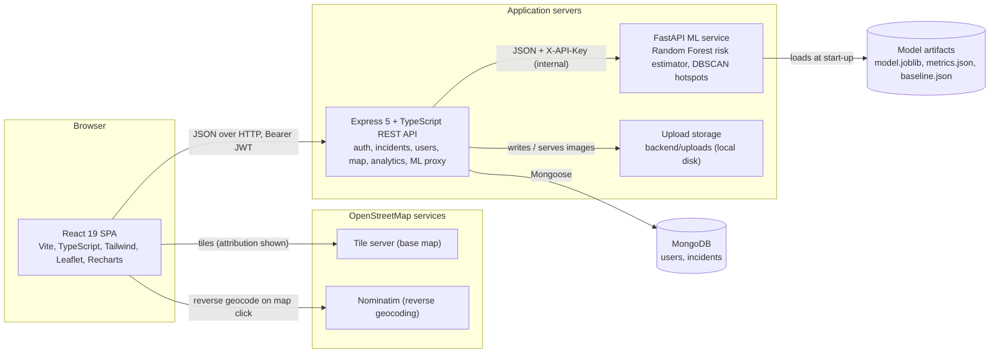
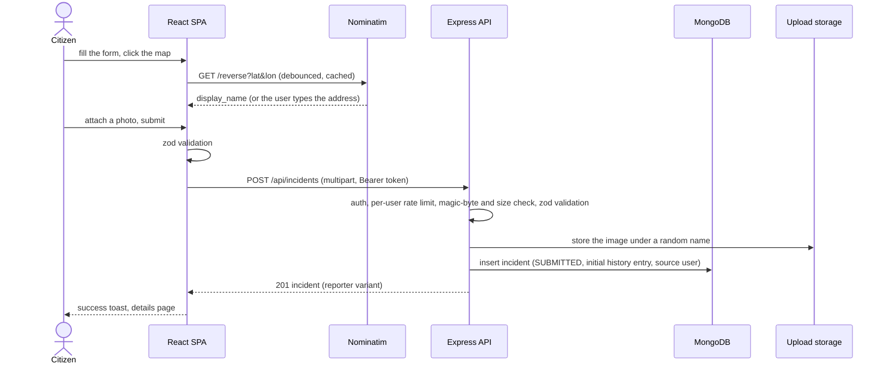
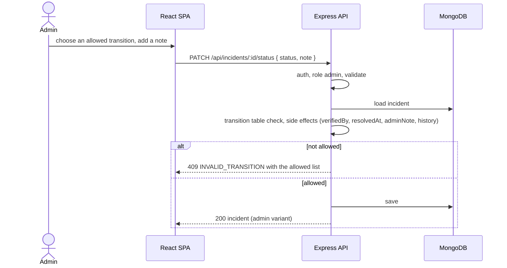
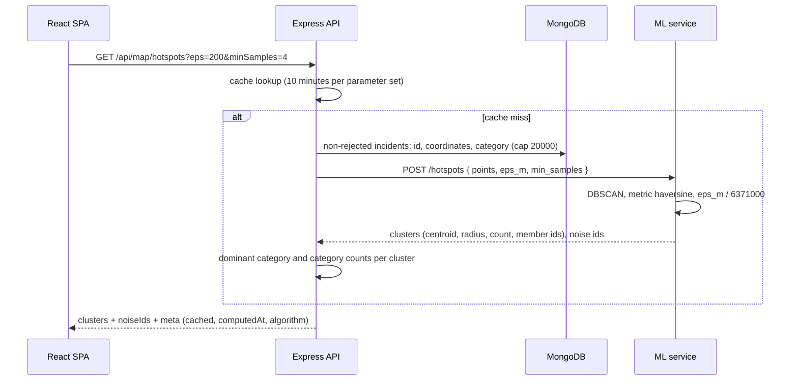

# SmartRoad architecture

SmartRoad is a modular monolith for the web application plus one auxiliary Python service. There are exactly four deployable units: the React single-page application, the Express API, the MongoDB database and the FastAPI ML service. The ML service is separate only because scikit-learn is a Python library; nothing else is split into services.

## 1. Overview



Rules that follow from this picture:

- The browser talks to exactly one backend, the Express API. It never calls the ML service or the database directly.
- The ML service has no database connection. The backend sends it feature values or coordinate lists and stores nothing on the ML side except the artifacts produced by training.
- Map tiles and reverse geocoding are fetched by the browser from OpenStreetMap services, which are meant to be used that way.
- Uploads are stored on the backend host's disk behind a small storage adapter (`backend/src/lib/storage.ts`) so a cloud object store can replace it without touching the incident code.

## 2. Component responsibilities

| Component | Owns | Does not own |
|---|---|---|
| React SPA (`frontend/`) | Routing, forms and client-side validation, map rendering, charts, calling the API, storing the JWT, loading/empty/error states, accessibility. | Business rules beyond hints for the user; secrets. |
| Express API (`backend/`) | Authentication and authorisation, validation, incident lifecycle rules, database access, aggregation queries, file uploads, calling the ML service and caching its results, the error format. | Model training; rendering HTML. |
| MongoDB | Persistent storage, indexes (including 2dsphere), aggregation execution. | Application logic. |
| ML service (`ml/app`) | Loading trained artifacts, serving risk estimates and contributions, running DBSCAN, reporting model metadata and metrics. | User data; end-user authentication (it trusts the backend through a shared API key). |
| Training pipeline (`ml/training`, `data/`) | Dataset loading and validation, exploration, preprocessing, model comparison, evaluation, artifact export, demo dataset generation. | Anything at request time. |

## 3. Backend layering

```
request
  -> middleware (helmet, cors, json, rate limits, auth, role, validate, upload)
  -> route (URL to controller)
  -> controller (parse the validated request, call a service, shape the envelope)
  -> service (business rules: lifecycle, privacy, aggregation, ML calls, caching)
  -> model (Mongoose) / mlClient / storage adapter
```

Controllers never touch Mongoose directly and services never read `req` or write `res`. Enumerations live in `backend/src/config/enums.ts` and `categories.ts`; errors are `AppError` instances with codes from `backend/src/lib/errors.ts`; input schemas are zod objects in `backend/src/validation/`.

```
backend/src/
  server.ts            start-up: connect, listen, graceful shutdown
  app.ts               express app: security middleware, routes, static uploads, error handler
  config/              env.ts (validated environment), db.ts, enums.ts, categories.ts
  middleware/          auth.ts, requireRole.ts, validate.ts, rateLimit.ts, upload.ts, errorHandler.ts
  models/              User.ts, Incident.ts
  routes/ controllers/ one file per resource (auth, users, incidents, analytics, map, ml, meta, health)
  services/            auth, user, incident, incidentStatus, analytics, map, hotspot, ml, riskFeatures
  validation/          zod schemas per resource plus common.schema.ts
  lib/                 errors, geo, cache, mlClient, serializers, storage, pagination, incidentFilters, time, case
  scripts/             seed.ts, createAdmin.ts, deactivateUser.ts (+ lib/)
```

## 4. Frontend structure

```
frontend/src/
  main.tsx, App.tsx        providers (Query, Auth, Meta, Toast, Router) and the route table
  api/                     axios client with error normalisation; typed functions and TanStack Query hooks per resource
  auth/                    AuthContext, RequireAuth, RequireRole
  meta/                    MetaContext: categories and enums fetched once from the API
  constants/               enums.ts (mirrors docs/api.md), colors.ts (status, severity, priority, risk, verification)
  components/ui/           design-system primitives (Button, Field, Badge, Dialog, Toast, DataTable, StatCard, ...)
  components/layout/       PublicLayout, AppLayout (citizen), AdminLayout
  components/map/          MapCanvas, IncidentMarkers, Legend, MapFilters, LocationPicker, MiniMap, HotspotLayer, MapStatusBar
  components/charts/       ChartCard and Recharts wrappers plus domain charts
  features/public|citizen|admin   page-specific helpers and sections (URL params, presets, landing content)
  config.ts                VITE_* settings with defaults
  components/incidents/    IncidentForm, ImageDropzone, StatusTimeline, IncidentFacts, ...
  pages/public|citizen|admin
  hooks/, utils/, types/
```

Server state goes through TanStack Query hooks; authentication state lives in `AuthContext` with the token in `localStorage`; filters live in the URL so views can be shared and the back button works.

## 5. Main request flows

### 5.1 Citizen reports an incident



### 5.2 Admin changes status



### 5.3 Hotspot layer



### 5.4 Risk estimate for a stored incident

```mermaid
sequenceDiagram
    actor A as Admin
    participant SPA as React SPA
    participant API as Express API
    participant ML as ML service
    participant DB as MongoDB

    A->>SPA: open an incident, click "Estimate risk"
    SPA->>API: GET /api/ml/incidents/:id/risk
    API->>DB: load incident
    API->>API: derive hour, day, month, light, category; assume weather, road type, speed limit, area
    API->>ML: POST /estimate/risk { features }
    ML->>ML: pipeline.predict_proba, baseline-substitution contributions
    ML-->>API: risk_level, probabilities, contributions, model_version
    API->>DB: store riskEstimate on the incident
    API-->>SPA: estimate + features + assumedFeatures + disclaimer
```

## 6. Technology choices

| Layer | Choice | Why |
|---|---|---|
| Frontend | React 19, Vite 7, TypeScript, Tailwind CSS 4, react-router 7, TanStack Query 5 | The team knows React; Vite gives a fast dev server and a static build; TypeScript types are generated from the API contract; Tailwind tokens keep the visual identity in one file. |
| Map | Leaflet 1.9, react-leaflet 5, react-leaflet-cluster, OpenStreetMap tiles | No API key or billing; declarative markers and layers; clustering keeps 1000+ markers readable. |
| Charts | Recharts 3 | React components, small API, sufficient for bar, donut and line charts. |
| Forms | react-hook-form + zod | Same validation vocabulary as the backend. |
| Backend | Node.js, Express 5, TypeScript, zod 4, Mongoose 9 | Least ceremony for a REST API; Express 5 handles async errors natively; zod validates and blocks operator injection. |
| Auth | jsonwebtoken (HS256) + bcryptjs | Stateless, testable; bcryptjs avoids native compilation on Windows laptops. |
| Uploads | multer (memory) + file-type + local disk adapter | Nothing touches the disk before the magic-byte check; the adapter isolates storage. |
| ML | Python, pandas, NumPy, scikit-learn, joblib, FastAPI | Tabular data suits classical models; scikit-learn provides the classifiers, DBSCAN and metrics in one library; FastAPI validates requests with pydantic. |
| Tests | vitest + supertest (backend), vitest + Testing Library (frontend), pytest (ML), a Node end-to-end smoke test | One runner family for the JavaScript side; the e2e test exercises the complete demo workflow against the contract. |

## 7. Cross-cutting conventions

- Enumerations from `docs/api.md` section 2 are defined once per service and the backend serves them at `/api/meta/enums` so the frontend can stay in sync.
- Timestamps are stored and transmitted in UTC ISO 8601; the UI formats them in the browser locale; temporal ML features and timeline buckets use `ANALYTICS_TIMEZONE`.
- Coordinates: API fields `latitude` and `longitude`; storage as GeoJSON; only the map endpoint returns GeoJSON.
- Ids are ObjectId strings.
- Logging: morgan with the format from `LOG_FORMAT` (default `dev`; set `combined` in production), no request bodies logged.

## 8. Deployment sketch

Development runs everything on one machine: Vite on 5173, Express on 5000, MongoDB on 27017, FastAPI on 8000. For deployment the SPA is a static build, the API and the ML service are two web services (the ML service on a private address behind the shared API key), MongoDB is a managed cluster, and uploads either use a persistent disk or a cloud adapter. Details and the exact steps are in `docs/deployment.md`.
