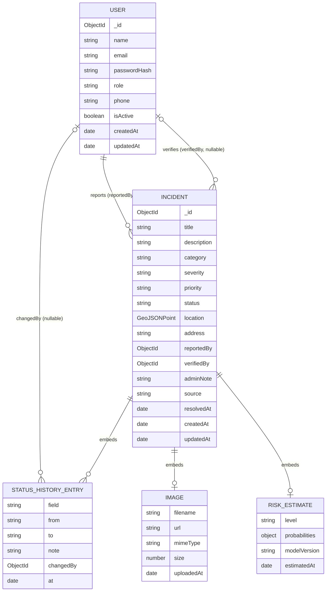

# SmartRoad database

MongoDB with Mongoose 9. Two collections carry the whole application: `users` and `incidents`. Status history and the latest risk estimate are embedded in the incident because they are always read with it, are small, and are never queried on their own. Categories live in code (`backend/src/config/categories.ts`) and are served by `GET /api/meta/categories`. Model artifacts live on the ML service's disk, not in the database.

## 1. Entity relationship diagram

## 2. `users`

| Field | Type | Rules |
|---|---|---|
| `_id` | ObjectId | Generated. |
| `name` | String | Required, trimmed, 2 to 80 characters. |
| `email` | String | Required, unique, lowercased, trimmed, valid format. Unique index. |
| `passwordHash` | String | Required. `select: false`; only `User.findByEmailWithPassword()` loads it. Produced by `User.hashPassword(plain)` (bcryptjs, cost `BCRYPT_ROUNDS`). |
| `role` | `citizen` or `admin` | Default `citizen`. Registration ignores any `role` in the body. |
| `phone` | String or null | Optional; 10 to 15 digits with optional leading `+`. |
| `isActive` | Boolean | Default `true`. Deactivated accounts are rejected by the auth middleware on every request; incidents keep a valid reporter reference. |
| `createdAt`, `updatedAt` | Date | Mongoose timestamps. |

Methods: `comparePassword(plain)`, `toProfile()`. Statics: `hashPassword(plain)`, `findByEmailWithPassword(email)`. `toJSON` removes `passwordHash` and `__v` and renames `_id` to `id`.

## 3. `incidents`

| Field | Type | Rules |
|---|---|---|
| `_id` | ObjectId | Generated. |
| `title` | String | Required, trimmed, 5 to 120 characters. |
| `description` | String | Required, trimmed, 10 to 2000 characters. |
| `category` | String | Required; validated at runtime against the category keys in code (ten keys, see `docs/api.md` section 2). |
| `severity` | `LOW`, `MEDIUM`, `HIGH` | Required; set by the reporter. |
| `priority` | `LOW`, `MEDIUM`, `HIGH`, `CRITICAL` or `null` | Default `null` (unassigned); only admins set it. |
| `status` | `SUBMITTED`, `UNDER_REVIEW`, `VERIFIED`, `IN_PROGRESS`, `RESOLVED`, `REJECTED` | Default `SUBMITTED`; changed only through the status service, which enforces transitions. |
| `location` | GeoJSON Point `{ type: "Point", coordinates: [lng, lat] }` | Required; ranges validated. 2dsphere index. |
| `address` | String | Optional, trimmed, up to 300 characters. |
| `image` | `{ filename, url, mimeType, size, uploadedAt }` or `null` | `filename` is server-generated; `mimeType` one of `image/jpeg`, `image/png`, `image/webp`. |
| `reportedBy` | ObjectId ref `User` | Required, immutable. |
| `verifiedBy` | ObjectId ref `User` or `null` | Set on the first VERIFIED. |
| `adminNote` | String or `null` | Latest admin note (for example the rejection reason); cleared when a rejected incident is reconsidered. Visible to the reporter. |
| `statusHistory` | Array of entries (3.1) | Starts with `{ field: "status", from: null, to: "SUBMITTED" }`; append-only. |
| `riskEstimate` | `{ level, probabilities: { LOW, MEDIUM, HIGH }, modelVersion, estimatedAt }` or `null` | Written by the ML proxy when an admin requests an estimate for the incident or runs a refresh. Only admins see it. |
| `source` | `user` or `seed` | Default `user`; `seed` marks demo data. |
| `resolvedAt` | Date or `null` | Set on RESOLVED, cleared on reopen. |
| `createdAt`, `updatedAt` | Date | Mongoose timestamps; `createdAt` is the reporting time used by analytics and for the derived temporal risk features. |

### 3.1 `statusHistory` entry

| Field | Type | Rules |
|---|---|---|
| `field` | `status` or `priority` | Which attribute changed. |
| `from` | String or `null` | Previous value (`UNASSIGNED` is used for a cleared priority in `to`). |
| `to` | String | New value. |
| `note` | String or `null` | Up to 1000 characters; required by the service when `to` is `REJECTED`. |
| `changedBy` | ObjectId ref `User` or `null` | `null` for the initial entry. |
| `at` | Date | Default now. |

### 3.2 Virtuals and serialisation

- Virtuals `latitude` and `longitude` read `location.coordinates[1]` and `[0]`.
- The serializer (`backend/src/lib/serializers.ts`) outputs `id`, `latitude`, `longitude`, the derived `verification` state, and applies the privacy variants in `docs/api.md` section 6.1. The raw `location` array is never exposed except through the GeoJSON map endpoint.

### 3.3 Indexes

| Index | Purpose |
|---|---|
| `{ location: "2dsphere" }` | Bounding-box queries for the map and the hotspot input. |
| `{ status: 1, createdAt: -1 }` | Admin lists filtered by status; dashboard counts. |
| `{ category: 1, createdAt: -1 }` | Category filters and analytics. |
| `{ reportedBy: 1, createdAt: -1 }` | "My reports" and citizen counts. |
| `{ priority: 1, status: 1 }` | High-priority open incidents. |
| `{ "riskEstimate.level": 1 }` | Risk distribution and risk filters. |
| `{ createdAt: -1 }` | Timeline analytics and default sort. |
| `users { email: 1 }` unique | Login and uniqueness. |

Free-text search uses a case-insensitive, regex-escaped substring match over `title`, `description` and `address`; at the project's volume (under 10,000 records) this is fast enough and matches what users expect. Sorting by priority or severity in rank order uses an aggregation `$addFields` rank map.

## 4. Aggregations used by analytics

| Endpoint | Pipeline |
|---|---|
| Summary | `$match` (date range, optional `source`), `$group` by `status`; high-priority open = `$match { priority: { $in: [HIGH, CRITICAL] }, status: { $nin: [RESOLVED, REJECTED] } }`. |
| Breakdown | `$match`, `$group` by the chosen field, `$sort`. Null priority becomes `UNASSIGNED`; missing risk estimate becomes `NONE`. |
| Timeline | `$match`, `$group` by `$dateTrunc` (`day`, `week` with `startOfWeek: "monday"`, or `month`) in `ANALYTICS_TIMEZONE`, then gaps are filled in the service. |
| Map | `find` with filters plus `location: { $geoWithin: { $geometry: <bbox polygon> } }` when a bbox is given (the `$box` shorthand only works with the legacy 2d index). |
| Hotspot input | `find` non-rejected with projection `{ _id, location, category }`, optional filters, capped at 20,000 points. |
| Risk distribution | `$group` by `riskEstimate.level` (null as `NONE`), distinct model versions, max `estimatedAt`. |

`$dateTrunc` requires MongoDB 5.0 or later.

## 5. Seed data

`npm run seed` (in `backend/`) upserts the demo administrator from `SEED_ADMIN_EMAIL` / `SEED_ADMIN_PASSWORD`, three demo citizens (`citizen1@smartroad.demo` to `citizen3@smartroad.demo`, password `SEED_DEMO_PASSWORD`) and replaces the curated demo incident set (`source: "seed"`, spread across Hyderabad localities, every category and status, several deliberate clusters for DBSCAN and isolated points that should be noise). `npm run seed:load` adds 1000 generated incidents for performance checks; `npm run seed:clear` removes every seed incident and never touches user reports. The UI labels seed records "Demo data" and public statistics exclude them.

## 6. What is deliberately not modelled

No separate categories, notifications, comments, assignments or predictions collections. An audit log beyond the incident history is listed in `docs/future-scope.md`.
