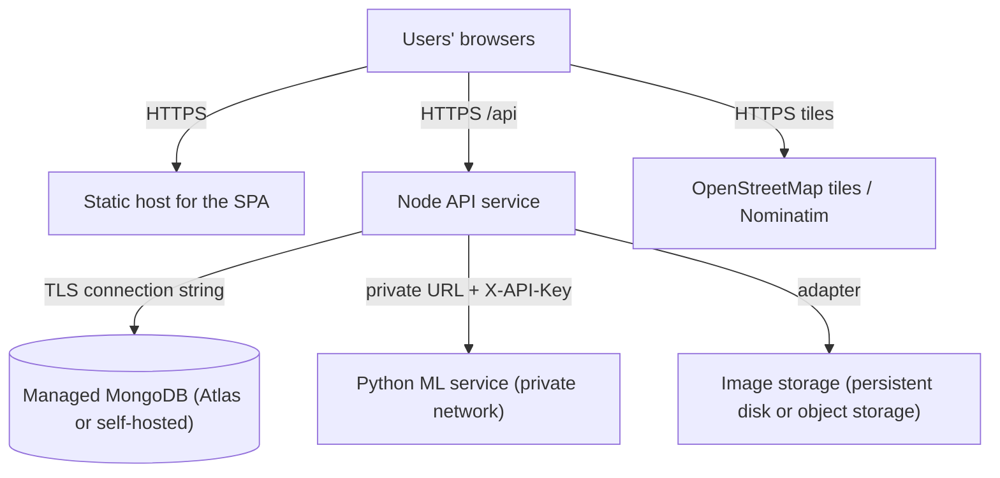

# SmartRoad deployment and operations

This guide covers running SmartRoad on a development machine (the configuration used for the project demo) and the steps needed to deploy the three services elsewhere. Nothing here assumes a specific hosting provider's free tier; check the provider's current documentation on the day of deployment.

## 1. Prerequisites

| Requirement | Notes |
|---|---|
| Node.js 20.11 or newer (24 used during development) | `node -v` |
| npm 10 or newer | ships with Node |
| Python 3.11 or newer (3.14 used during development) | `python --version`; scikit-learn, pandas and numpy wheels exist for 3.11 to 3.14 |
| MongoDB 5.0 or newer | a local server, a Docker container (`docker compose up -d mongo`) or a MongoDB Atlas cluster; `$dateTrunc` needs 5.0+ |
| Git | optional for development, needed for CI |

## 2. Development setup (one machine)

```bash
npm run install:all
```

This installs the root tooling, `backend/`, `frontend/`, creates `ml/.venv` and installs the Python requirements.

Create the three environment files from their examples and edit them:

```bash
cp backend/.env.example backend/.env
cp frontend/.env.example frontend/.env
cp ml/.env.example ml/.env
```

Minimum edits in `backend/.env`: `MONGODB_URI` (default local), `JWT_SECRET` (any 32+ random characters), and the demo passwords `SEED_ADMIN_PASSWORD` and `SEED_DEMO_PASSWORD`. The other files work with their defaults on one machine.

Train the demo model once (writes `ml/artifacts/`), then seed the database:

```bash
npm run ml:train
npm run seed
```

Start everything:

```bash
npm run dev
```

| Service | URL |
|---|---|
| Frontend (Vite) | http://localhost:5173 |
| API (Express) | http://localhost:5000/api (health at `/api/health`) |
| ML service (FastAPI) | http://127.0.0.1:8000 (interactive docs at `/docs`) |

Use `npm run dev:web` to start only the API and the frontend (the ML panels then show "ML service unavailable", which is the designed behaviour).

## 3. Environment variables

The complete reference copy is the root `.env.example`; each service reads only its own file.

### backend/.env

| Variable | Purpose | Default |
|---|---|---|
| `NODE_ENV` | development, test or production | development |
| `API_PORT` | port of the API (deliberately not `PORT`, so a platform-injected `PORT` for the frontend cannot redirect the API) | 5000 |
| `MONGODB_URI` | MongoDB connection string | mongodb://127.0.0.1:27017/smartroad |
| `JWT_SECRET` | at least 32 characters; validated at start-up | none (required) |
| `JWT_EXPIRES_IN` | token lifetime | 24h |
| `BCRYPT_ROUNDS` | bcrypt cost | 10 |
| `CORS_ORIGIN` | comma-separated allowed origins | http://localhost:5173 |
| `FRONTEND_URL` | public address of the SPA | http://localhost:5173 |
| `UPLOAD_DIR`, `MAX_UPLOAD_MB` | image storage directory and size limit | uploads, 5 |
| `ML_SERVICE_URL`, `ML_SERVICE_API_KEY`, `ML_TIMEOUT_MS` | ML service address, shared key, timeout | http://127.0.0.1:8000, empty, 8000 |
| `ANALYTICS_TIMEZONE` | timezone for timeline buckets and derived temporal features | Asia/Kolkata |
| `SEED_ADMIN_NAME`, `SEED_ADMIN_EMAIL`, `SEED_ADMIN_PASSWORD`, `SEED_DEMO_PASSWORD` | demo accounts created by `npm run seed` | see example |
| `MAP_CENTER_LAT`, `MAP_CENTER_LNG`, `MAP_ZOOM` | default map view | Hyderabad, 12 |
| `TRUST_PROXY` | 1 behind a reverse proxy | 0 |
| `RATE_LIMIT_*` | rate limits | see example |
| `LOG_FORMAT` | dev, combined or none | dev |
| `MONGODB_TEST_URI` | MongoDB used by integration tests | local server when reachable |

### frontend/.env

| Variable | Purpose | Default |
|---|---|---|
| `VITE_API_URL` | API origin | http://localhost:5000 |
| `VITE_TILE_URL`, `VITE_TILE_ATTRIBUTION` | base map tiles and attribution | OpenStreetMap |
| `VITE_GEOCODE_URL` | reverse geocoding endpoint | Nominatim |

### ml/.env

| Variable | Purpose | Default |
|---|---|---|
| `ML_HOST`, `ML_PORT` | bind address | 127.0.0.1, 8000 |
| `ML_API_KEY` | shared key; empty disables the check with a warning | empty |
| `ML_ARTIFACTS_DIR` | where `model.joblib`, `metrics.json`, `baseline.json` live | artifacts |
| `ML_LOG_LEVEL` | logging level | info |

## 4. Production builds

```bash
npm run build:all          # backend -> backend/dist, frontend -> frontend/dist
```

- Backend: `cd backend && npm start` runs `node --env-file=.env dist/server.js`. On a platform that injects environment variables, omit the `.env` file and run `node dist/server.js`.
- Frontend: `frontend/dist` is a static site. Serve it from any static host with a single-page-application fallback (every unknown path serves `index.html`). Build-time variables (`VITE_*`) must be set before `npm run build`.
- ML service: `cd ml && .venv/bin/python -m uvicorn app.main:app --host 0.0.0.0 --port 8000` (or `node scripts/ml.js serve`). Copy or regenerate `ml/artifacts/` on the target machine; the artifacts are outputs of `npm run ml:train` and are not committed.

## 5. Deployment topology



Checklist for a deployment:

1. Set `NODE_ENV=production`, a fresh `JWT_SECRET`, `CORS_ORIGIN` to the SPA's origin, `TRUST_PROXY=1` behind the platform proxy, and `LOG_FORMAT=combined`.
2. Set the same random value for `ML_SERVICE_API_KEY` (backend) and `ML_API_KEY` (ML service) and keep the ML service off the public internet.
3. Use a MongoDB user with access to one database only; allow the API host's address in the cluster's network rules.
4. Uploads need a persistent disk at `UPLOAD_DIR`; platforms without one need the object-storage adapter listed in `docs/future-scope.md`.
5. Build the SPA with `VITE_API_URL` pointing at the public API origin.
6. Run the seed script once (`npm run seed`) with strong demo passwords, or create the administrator with `npm run create-admin -- --email ... --password ...` and skip the demo incidents.
7. Smoke-test with `API_URL=https://<api-host> ADMIN_EMAIL=... ADMIN_PASSWORD=... node tests/e2e/run.mjs`.

## 6. Operations

| Task | Command (from the repository root) |
|---|---|
| Health check | `curl https://<api>/api/health` (200 when the database answers; the ML status is informational) |
| Retrain the model | `npm run ml:train` then restart the ML service |
| Add an administrator | `cd backend && npm run create-admin -- --email x@y.z --password "..." --name "Name"` |
| Deactivate or reactivate an account | `cd backend && npm run deactivate-user -- --email x@y.z [--reactivate]` (or the admin Users page) |
| Remove demo incidents | `npm run seed:clear` |
| Performance data set | `npm run seed:load` (1000 generated incidents, `source: "seed"`) |
| Banned-phrase check | `npm run check:phrases` |

## 7. Windows and OneDrive note

The project folder can live inside OneDrive, but `node_modules`, `ml/.venv` and `backend/uploads` contain thousands of small files that OneDrive syncs slowly. Exclude those folders from syncing (or pause syncing during installs). Git ignores them either way.
