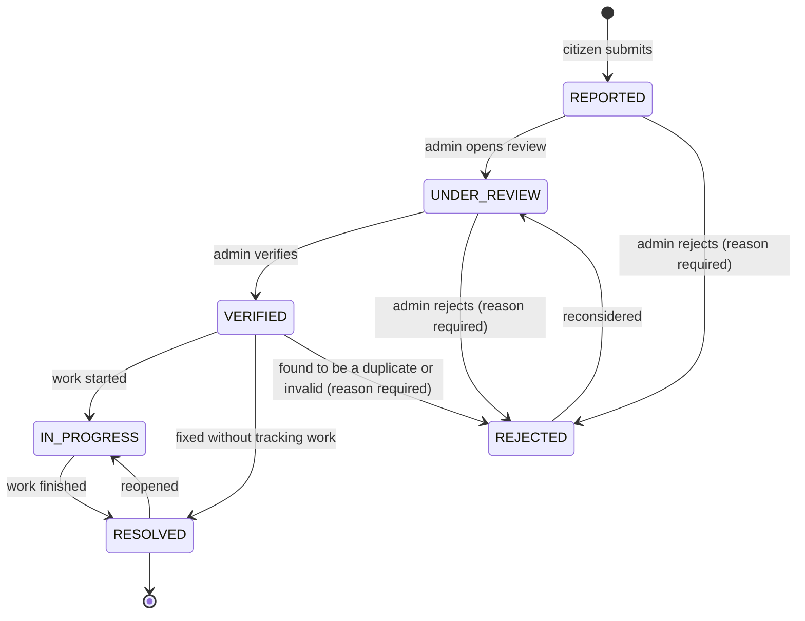

# SmartRoad Phase 1: requirements analysis

Document 01 of 06, Phase 1 deliverable. Version 0.1, draft for team review, 1 September 2026.

Project: SmartRoad, "An Intelligent Web-Based Road Safety, Traffic Incident Management and Risk Prediction System". Team: Balaji Lakshmipathi (lead), Vivek Reddy, Arman Koyalkar. Project guide: Rajesh Adluri (as named in the accepted abstract). Acceptance: Aruja Jyothi Ma'am.

This document turns the project brief and the accepted abstract into a checkable list of requirements. Every later phase (schema, API, pages, ML) refers back to the IDs defined here. Where the brief was ambiguous, section 9 records the decision taken and the reason, so the team and the guide can challenge it before code is written.

## 1. Problem statement

Road incidents (accidents, potholes, damaged road surfaces, faulty traffic signals, obstructions, waterlogging and other hazards) are reported through separate channels: phone calls, paper records, social media posts and unrelated apps. Because the reports are scattered, nobody can easily verify them, track what happened to them, see where they cluster, or study past incidents to decide where attention is needed.

SmartRoad is a single web platform where citizens report incidents with a location and an optional photo, administrators verify, prioritise and track them to resolution, everyone can see incidents on a map, and administrators get analytics plus a machine-learning research view that estimates incident risk from historical data and finds spatial hotspots.

## 2. Scope

### 2.1 In scope

- Citizen registration and login; admin login; role-based access.
- Incident reporting with title, category, description, severity, map-picked or typed location, optional image.
- Incident lifecycle management by administrators: review, verify or reject, set priority, move through statuses to resolution, add notes.
- Citizen view of own reports and their current status and history.
- Interactive map of incidents with filters and popups (Leaflet + OpenStreetMap).
- Admin dashboard with counts and charts computed from the live database.
- Analytics views: incidents by category, status, priority and over time.
- Machine-learning research module: a documented, evaluated pipeline that classifies risk as LOW, MEDIUM or HIGH from historical incident data, with metrics, confusion matrix and feature importance shown in an admin-only view.
- Hotspot detection with DBSCAN on incident coordinates, shown as a map layer.
- Basic security: password hashing, JWT, role checks, validation, safe uploads, environment-based secrets, CORS, error handling.
- Responsive UI, testing, deployment and documentation (later phases).

### 2.2 Out of scope (stated as future work, never claimed as features)

- IoT sensors, dashcams, CCTV or any computer-vision detection of hazards.
- Live traffic feeds, "real-time" alerts, WebSockets or push notifications.
- SMS or email notifications (status is shown in-app only).
- Assignment of incidents to field crews or integration with municipal ticketing systems.
- Native mobile apps (the web UI is responsive instead).
- Multi-city tenancy, payments, public commenting, social features.
- Any claim that the system predicts individual accidents or reduces accidents by a measured percentage.

## 3. Stakeholders

| Stakeholder | Interest in SmartRoad |
|---|---|
| Citizens (registered users) | Report incidents quickly, see that reports are acted on, see hazards near them on the map. |
| Administrators (road authority staff in the scenario; the team during the demo) | Verify reports, prioritise work, track resolution, understand where incidents cluster. |
| Visitors (not logged in) | Look at the public map and summary statistics; decide whether to register. |
| Project guide and reviewers | A working, honest, well-documented system with a defensible ML component. |
| Team | A scope that three students can finish in one academic year. |

## 4. User roles

Three roles exist at runtime. Only two are stored in the database; the third is the absence of a login.

| Role | Stored as | What they can do |
|---|---|---|
| Visitor | (no account) | View landing page, public summary statistics and the public map (read-only, reporter identity hidden). Register or log in. |
| Citizen | `role: "citizen"` | Everything a visitor can do, plus report incidents, view and edit own reports (only while status is REPORTED), view status history of own reports, manage own profile. |
| Admin | `role: "admin"` | Everything a citizen can do, plus view all incidents including reporter identity and rejected ones, filter and search, change status and priority, add notes, delete records, view analytics, the ML research view and hotspot layer. |

Admins are never created through the public registration form. The first admin is created by a seed script from environment variables; further admins are created by an admin-only script or database update (see decision D-03).

## 5. Functional requirements

Priority: M = must have (needed for the final demo), S = should have (planned, cut only under time pressure), C = could have (only if time permits).

### 5.1 Authentication and accounts (FR-A)

| ID | Requirement | Priority |
|---|---|---|
| FR-A1 | A visitor can register with name, email and password. Email must be unique. Password must be 8 to 72 characters (bcrypt ignores bytes beyond 72). | M |
| FR-A2 | A registered user can log in with email and password and receives a signed JWT containing user id and role. | M |
| FR-A3 | Passwords are stored only as bcrypt hashes. | M |
| FR-A4 | Every protected API route rejects requests without a valid, unexpired token. | M |
| FR-A5 | Admin-only routes reject tokens whose role is not `admin`, even if the token is valid. | M |
| FR-A6 | A logged-in user can view and update their own profile (name, phone) and change their password after supplying the current one. | S |
| FR-A7 | Login and registration attempts are rate-limited per IP to slow down password guessing. Other authenticated calls are not covered by this limit. | S |
| FR-A8 | The admin login page uses the same authentication endpoint as citizens; it only differs in presentation and redirects non-admin accounts to the citizen area with an explanation. | M |

### 5.2 Incident reporting (FR-R)

| ID | Requirement | Priority |
|---|---|---|
| FR-R1 | A citizen can submit an incident with: title (5 to 120 characters), category (one of the configured keys), description (10 to 2000 characters), severity (LOW, MEDIUM, HIGH), location (latitude, longitude) and an optional address text. | M |
| FR-R2 | The location can be chosen by clicking on a map, by using the browser's geolocation, or by typing coordinates. | M |
| FR-R3 | When a map location is chosen, the form tries to fill the address by reverse geocoding (OpenStreetMap Nominatim) and lets the user edit it. If geocoding fails, the user types the address or leaves it blank. | S |
| FR-R4 | A citizen can attach at most one image (JPEG, PNG or WebP, at most 5 MB). The server validates type by content and size, re-encodes the image (which strips metadata), and never trusts the client-supplied file name. | M |
| FR-R5 | The form validates inputs before submission and shows a specific message next to each invalid field (for example "Latitude must be between -90 and 90"). The server repeats all validation. | M |
| FR-R6 | A new incident starts with status REPORTED, priority unassigned, and records who reported it and when. | M |
| FR-R7 | A citizen can see a list of their own reports with status, category, severity, priority (if assigned) and date, sorted newest first, with pagination. | M |
| FR-R8 | A citizen can open one of their reports and see all details, the image, the location on a small map, and the full status history including every admin note. There are no internal notes: anything an admin writes on an incident is visible to its reporter. | M |
| FR-R9 | A citizen can edit title, description, severity, location and image of their own report only while its status is REPORTED. After that the report is read-only for the citizen. | S |
| FR-R10 | The category list is defined in one configuration file on the backend and served to the frontend, so adding a category does not require a database migration or frontend redeploy beyond reading the new list. | M |

### 5.3 Incident management (FR-M)

| ID | Requirement | Priority |
|---|---|---|
| FR-M1 | An admin can list all incidents with filters for status, category, priority, severity, date range and a case-insensitive substring search over title, description and address. Results are paginated and sortable by date, priority, severity and status (priority and severity in rank order, not alphabetical). | M |
| FR-M2 | An admin can open any incident and see every field, the reporter's name and email, the image and the status history. | M |
| FR-M3 | An admin can change the status following the allowed transitions in section 8, optionally adding a note. Invalid transitions are rejected by the server with a clear message. | M |
| FR-M4 | An admin can set or change the priority (LOW, MEDIUM, HIGH, CRITICAL). Priority is never set automatically; the UI must not suggest that it is. | M |
| FR-M5 | An admin must give a reason when rejecting an incident. The reason is visible to the reporter. | M |
| FR-M6 | Every status or priority change is appended to the incident's history with the admin's id, the previous and new value, the note and the timestamp. | M |
| FR-M7 | An admin can delete an incident record. The UI asks for confirmation. Deletion is permanent (no soft delete in this version, see D-08). | S |
| FR-M8 | When an incident is moved to RESOLVED, `resolvedAt` is set; if it is reopened, `resolvedAt` is cleared. | M |

### 5.4 Map and GIS (FR-G)

| ID | Requirement | Priority |
|---|---|---|
| FR-G1 | The map page shows incidents as markers on an OpenStreetMap base layer using Leaflet, centred by default on the configured city (Hyderabad) and zoom level. | M |
| FR-G2 | Marker colour encodes category by default; the user can switch to colouring by severity. A legend explains the colours. | M |
| FR-G3 | Clicking a marker opens a popup with title, category, severity, status, date and address. Signed-in users also get a link to the details page; visitors do not, because details require an account. The popup never shows reporter identity. | M |
| FR-G4 | The map can be filtered by category, status, severity, priority (admin) and date range; filters combine. | M |
| FR-G5 | Visitors and citizens never see REJECTED incidents on the map; admins can include them with a filter. | M |
| FR-G6 | The map requests only incidents inside the current viewport (bounding box) once the number of stored incidents makes a full download slow. Until then a full fetch with filters is acceptable. | S |
| FR-G7 | When the hotspot module exists, a toggleable layer draws each DBSCAN cluster as a circle (centroid and radius) with the incident count, and marks noise points differently. | S |
| FR-G8 | Nearby markers are grouped with marker clustering at low zoom levels so the map stays readable. | C |
| FR-G9 | Map tiles carry the OpenStreetMap attribution and the tile source URL is configurable in the environment. | M |

### 5.5 Dashboards and analytics (FR-D)

| ID | Requirement | Priority |
|---|---|---|
| FR-D1 | The citizen dashboard shows the user's own counts: total, pending (REPORTED + UNDER_REVIEW), active (VERIFIED + IN_PROGRESS, card labelled "Verified and in progress"), resolved, rejected, plus the five most recent reports and a prominent "Report an incident" button. | M |
| FR-D2 | The admin dashboard shows: total incidents, pending verification (REPORTED + UNDER_REVIEW), verified (VERIFIED only), active (VERIFIED + IN_PROGRESS; the card says that it includes the verified ones), resolved, rejected, and high-priority open incidents (HIGH or CRITICAL and not RESOLVED or REJECTED). These count definitions are the same in every endpoint and page. | M |
| FR-D3 | The admin dashboard shows charts for incidents by category, by status, by priority and over time (per day, week or month for a selected range). All values come from database aggregation queries; no static numbers. | M |
| FR-D4 | The admin dashboard embeds a small map with incident distribution and, when available, the hotspot layer. | S |
| FR-D5 | The landing page shows public aggregate figures (reports filed, reports resolved, reports in the last 30 days, resolved in the last 30 days) from a public endpoint. Public figures exclude REJECTED incidents and seed records, so a demo database with only seed data shows zeros rather than pretending to have traffic. Until the database is connected, the landing page shows no figures at all rather than placeholders. | M |
| FR-D6 | Admin analytics endpoints accept a date range, cover every status, and let the admin exclude seed records with a query flag; the page states when seed records are included. | S |

### 5.6 Machine-learning risk estimation (FR-ML)

| ID | Requirement | Priority |
|---|---|---|
| FR-ML1 | The team selects and documents a public historical road-incident dataset (name, source, URL, access date, licence, record count, features, missing values, class balance, geographic and temporal coverage, limitations) before any model is trained. | M |
| FR-ML2 | A reproducible training script cleans the data, engineers features that exist in the dataset (no invented features), splits with stratification, trains Logistic Regression, Decision Tree and Random Forest, and evaluates each with accuracy, precision, recall, F1 (macro and per class) and a confusion matrix on a held-out test set. | M |
| FR-ML3 | Class imbalance is handled explicitly (class weights or resampling), and the choice and its effect are documented. | M |
| FR-ML4 | The chosen model, its metrics, the confusion matrix, feature importance (for tree models) and the dataset card are saved as artifacts and loaded by the ML service at start-up. | M |
| FR-ML5 | The admin ML view displays dataset information, preprocessing summary, the model used, the evaluation metrics, the confusion matrix, feature importance and a form to request a risk estimate for a set of feature values. Every number shown is read from the artifacts of an actual run. | M |
| FR-ML6 | The risk estimate output is one of LOW, MEDIUM, HIGH with class probabilities, and the UI labels it as an estimate from historical data, never as an accident prediction. | M |
| FR-ML7 | Citizens never see ML internals. At most, an incident details page may show a labelled risk estimate if the team decides in Phase 8 that the model's inputs can be derived from SmartRoad's own incident data. | S |
| FR-ML8 | If the dataset turns out to be too small or too imbalanced for a reliable model, the ML view says so in plain words and presents the pipeline as a demonstrative academic experiment. | M |
| FR-ML9 | The web application keeps working when the ML service is down; ML panels show an "ML service unavailable" state. | M |

### 5.7 Hotspot detection (FR-H)

| ID | Requirement | Priority |
|---|---|---|
| FR-H1 | The ML service exposes a clustering endpoint that runs DBSCAN on a list of incident coordinates using haversine distance, with configurable `eps` (metres) and `min_samples`. | M |
| FR-H2 | The backend collects the coordinates of non-rejected incidents (optionally filtered by category and date range), calls the clustering endpoint, and returns clusters with centroid, radius, member count and member ids, plus the list of noise incident ids. | M |
| FR-H3 | Results are cached on the backend for a short time (about 10 minutes) so the map does not recompute clusters on every pan. | S |
| FR-H4 | The UI states that hotspots are density clusters of reported incidents, computed with DBSCAN, and not an output of the risk model. | M |
| FR-H5 | With fewer than `min_samples` incidents the endpoint returns an empty cluster list and the UI shows "not enough data for hotspots". | M |

### 5.8 Cross-cutting and system (FR-S)

| ID | Requirement | Priority |
|---|---|---|
| FR-S1 | All list endpoints support pagination (`page`, `limit`, maximum 100) and return the total count. | M |
| FR-S2 | All API errors use one JSON shape with a machine-readable code and a human-readable message; validation errors list the offending fields. | M |
| FR-S3 | The backend exposes a health endpoint reporting database and ML service connectivity. | S |
| FR-S4 | Seed data used for demos is stored with `source: "seed"` so it can be filtered out or labelled, and the seed script can remove it. | M |
| FR-S5 | Configuration (ports, database URI, secrets, map centre, tile URL, ML service URL) is read from environment variables; an `.env.example` documents every variable. | M |

## 6. Non-functional requirements

| ID | Category | Requirement |
|---|---|---|
| NFR-1 | Performance | With up to 10,000 incidents, list, map and analytics endpoints should respond within 500 ms at the server (measured in Phase 11 on the deployment target; the number is a target, not a claim). Indexes on status, category, createdAt, reportedBy and a 2dsphere index on location are mandatory. |
| NFR-2 | Performance | The map page should render 2,000 markers without freezing the browser; beyond that, viewport queries (FR-G6) or clustering (FR-G8) are required. |
| NFR-3 | Security | Password hashing with bcrypt (cost factor 10 to 12), JWT signed with a secret of at least 32 random bytes, role checks on the server for every admin action, input validation on every write endpoint, upload type and size checks, security headers (helmet), CORS restricted to configured origins, no stack traces in production responses, secrets only in environment variables. |
| NFR-4 | Availability | The application must function (reporting, management, map, analytics) when the ML service is unreachable. A failed ML call degrades only the ML and hotspot panels. |
| NFR-5 | Usability | Forms show inline validation messages; every asynchronous view has loading, empty and error states; destructive actions ask for confirmation; the primary citizen action (report) is reachable in one click from the dashboard. |
| NFR-6 | Responsiveness | Layouts work from 360 px wide phones to desktop. The map and forms are usable by touch. |
| NFR-7 | Accessibility (basic) | Form fields have labels, colour is never the only carrier of meaning (legend text, status text), interactive elements are keyboard reachable, contrast meets WCAG AA for text. |
| NFR-8 | Maintainability | Modular folders per feature, ESLint and Prettier on JavaScript, Ruff on Python, no file above roughly 300 lines without a reason, shared constants (enums) defined once per service. |
| NFR-9 | Portability | Development on Windows 10/11 and Linux with Node.js LTS, Python 3.11+, and either a local MongoDB or MongoDB Atlas. No platform-specific scripts in the main workflow. |
| NFR-10 | Data integrity | Server-side validation mirrors the schema; status transitions are enforced by the server; history entries are append-only. |
| NFR-11 | Reproducibility (ML) | Training runs are scripted, seeded with a fixed random state, and write a metrics file; the report and UI read from that file, never from hand-typed numbers. |
| NFR-12 | Privacy | Reporter identity is visible only to admins and the reporter. Photos may contain faces or number plates; the upload form warns users not to upload images of people, and admins can delete images. No location tracking beyond the coordinates the user submits. |
| NFR-13 | Honesty of claims | UI text, README and reports use "estimates", "historical data", "clusters of reports". The words "AI-powered", "real-time" and "predicts accidents" do not appear anywhere in the product. |
| NFR-14 | Third-party usage terms | OpenStreetMap tile and Nominatim usage follow their published policies (attribution, at most one geocoding request per second, an identifying Referer since browsers cannot set User-Agent, caching of results, and tile and geocoding URLs configurable so the service can be switched without a code change); heavy traffic would require a different provider. |

## 7. Domain vocabulary (single source of truth for enums)

These keys are used identically in the database, the API and the UI. Labels are for display and can be changed without touching stored data.

| Concept | Keys (stored) | Labels (shown) |
|---|---|---|
| Role | `citizen`, `admin` | Citizen, Administrator |
| Category | `ACCIDENT`, `POTHOLE`, `ROAD_DAMAGE`, `TRAFFIC_SIGNAL`, `OBSTRUCTION`, `WATERLOGGING`, `HAZARD`, `OTHER` | Accident, Pothole, Road damage, Traffic signal issue, Road obstruction, Waterlogging, Hazardous condition, Other |
| Severity (set by the reporter) | `LOW`, `MEDIUM`, `HIGH` | Low, Medium, High |
| Priority (set by an admin, null until assigned) | `LOW`, `MEDIUM`, `HIGH`, `CRITICAL` | Low, Medium, High, Critical |
| Status | `REPORTED`, `UNDER_REVIEW`, `VERIFIED`, `IN_PROGRESS`, `RESOLVED`, `REJECTED` | Reported, Under review, Verified, In progress, Resolved, Rejected |
| Record source | `user`, `seed` | (label "Demo data" shown for seed) |
| Risk level (ML output) | `LOW`, `MEDIUM`, `HIGH` | Low risk, Medium risk, High risk |

Severity and priority are deliberately different things: severity is the reporter's view of how bad the incident looks; priority is the administrator's decision about urgency after review. The UI never shows one as if it were the other.

## 8. Incident lifecycle

Allowed transitions (server-enforced):

| From | To |
|---|---|
| REPORTED | UNDER_REVIEW, REJECTED |
| UNDER_REVIEW | VERIFIED, REJECTED |
| VERIFIED | IN_PROGRESS, RESOLVED, REJECTED |
| IN_PROGRESS | RESOLVED |
| RESOLVED | IN_PROGRESS (reopen) |
| REJECTED | UNDER_REVIEW (reconsider) |

Rules: only admins change status; REJECTED requires a note; an incident whose work has started (IN_PROGRESS) cannot be rejected, only resolved or reopened later; RESOLVED sets `resolvedAt`; reopening clears it; reconsidering a rejected incident clears `adminNote` (the rejection reason stays in the history); every change appends a history entry.

## 9. Ambiguities and decisions

| ID | Question | Decision | Reason |
|---|---|---|---|
| D-01 | JavaScript or TypeScript? | JavaScript for frontend and backend. | Chosen by the team on 1 Sep 2026. Lowest learning cost for three people; the abstract allows either. Validation schemas (zod) give runtime type checks where they matter. |
| D-02 | Which city for the default map centre and demo data? | Hyderabad (17.3850, 78.4867, zoom 12), configurable in `.env`. | Chosen by the team. Seed incidents will use real Hyderabad road locations. |
| D-03 | How are admins created? | Seed script from `SEED_ADMIN_EMAIL` / `SEED_ADMIN_PASSWORD`; extra admins via an admin-only CLI script. No admin sign-up form. | An open admin registration would defeat role-based access. |
| D-04 | Is there a separate admin login page? | Yes, as a thin variant of the login form at `/admin/login` using the same API. | The brief lists it; keeping it costs little. It adds presentation, not security: the server enforces roles on every admin route regardless of which page issued the token. |
| D-05 | Can visitors report anonymously? | No. Reporting requires an account. | The brief requires registration; accountability reduces spam; the seed data covers demo volume. |
| D-06 | Who sets severity, who sets priority? | Reporter sets severity (LOW/MEDIUM/HIGH); admin sets priority (LOW/MEDIUM/HIGH/CRITICAL), null until assigned. | Keeps "how bad it looks" separate from "how urgent we treat it" and avoids pretending priority is automatic. |
| D-07 | Which incidents appear on the public map? | All statuses except REJECTED, with the status shown in the popup; admins can include REJECTED. | Showing only verified incidents would leave the map empty early on; the visible status keeps it honest. |
| D-08 | Soft delete or hard delete? | Hard delete by admins only, with confirmation. Citizens cannot delete. | Soft delete adds filters to every query for little benefit in a student system. The status history already records rejections, which is the usual way to "remove" a bad report. |
| D-09 | How many images per incident? | One optional image, at most 5 MB, JPEG/PNG/WebP, re-encoded on the server (which also strips EXIF metadata such as GPS tags) and stored on the backend's disk under an `uploads/` directory that is not in git. | Multiple images complicate the form and storage; one is enough for verification. A storage adapter keeps the door open for cloud storage at deployment (Phase 12). |
| D-10 | How is the address obtained? | Client-side reverse geocoding with Nominatim after a map click, editable by the user, with typed fallback. Cached per coordinate in the browser session; the geocoding URL comes from `.env` so the service can be switched. | Free, no key, fits the OSM stack. Nominatim's usage policy (at most one request per second, identifying Referer, cached results, switchable service, no bulk queries) is acceptable for a student project's traffic. |
| D-11 | Notifications? | In-app only: the citizen sees status and history on My reports and Incident details. No email or SMS. | Email delivery needs a provider account and credentials; it is listed as future scope. |
| D-12 | Real-time updates? | None. Pages fetch on load and on explicit refresh. | No WebSockets, so the word "real-time" is never used. |
| D-13 | Categories in the database or in code? | In code (one config module on the backend), served to the frontend by `GET /api/meta/categories`. | "Extensible" is satisfied by editing one list; a categories collection with admin CRUD is more than the project needs. |
| D-14 | Where does the ML model run? | A separate Python FastAPI service called only by the backend, never by the browser. | scikit-learn lives in Python; keeping the browser away from it means one place for authentication and no CORS exposure of the ML service. |
| D-15 | What does "risk" mean for the model? | Risk level = the severity class an incident is estimated to have, given its context features, learned from a historical dataset. It is not a probability that an accident will happen at a place. | The abstract promises LOW/MEDIUM/HIGH risk classification; this definition can be trained and evaluated honestly with public data. Details in `02-architecture.md` section 6. |
| D-16 | Does the risk model use SmartRoad's own incidents? | Not for training in this academic year (too few records). Hotspots (DBSCAN) do use SmartRoad's own incidents. The pipeline is written so it can be retrained on SmartRoad data later. | Avoids claiming a model trained on a few dozen demo reports. |
| D-17 | Token storage in the browser? | JWT in `localStorage`, sent as a Bearer header. Expiry 24 hours. | Simplest working option for a SPA and a student team. The trade-off (XSS exposure) and mitigations are documented in the security architecture. |
| D-18 | PUT or PATCH for updates? | PATCH only. | Partial updates are what the UI sends; full replacement (PUT) would need every field each time and is easy to misuse. |
| D-19 | Build tool for React? | Vite. | Create React App is no longer maintained; Vite is the standard choice with fast dev server and small config. |
| D-20 | UI styling approach? | Plain CSS with CSS variables (design tokens) and CSS Modules, no UI kit. Tailwind is acceptable if the frontend owner prefers it, decided at the start of Phase 3. | Avoids the "generic template" look the brief warns about and keeps the bundle small. |
| D-21 | Backend module system, Express major version and test runner? | Express 5, ES modules (`"type": "module"`), vitest with supertest and mongodb-memory-server. No `express-mongo-sanitize` (it does not work with Express 5); zod schemas that only accept primitive types for every input cover operator injection instead. | Express 5 is the current major; ESM is required by `file-type` and is the default in current Node tooling; vitest is the same runner the frontend uses. |
| D-22 | Free-text search implementation? | Case-insensitive regular expression over title, description and address (substring match). No MongoDB text index. | Under 10,000 documents the regex is fast enough, and substring matching ("Hitec" found by "Hite") is what users expect; a text index matches whole stemmed words only. |
| D-23 | React major and map binding versions? | React 19 (the current Vite template default) with react-leaflet 5 and Recharts 3. If any pairing fails at install time, fall back to React 18 with react-leaflet 4. | react-leaflet 5 requires React 19; the pairing is checked when Phase 3 scaffolds the frontend, not assumed. |
| D-24 | Which bcrypt implementation? | `bcryptjs` (pure JavaScript implementation of the bcrypt algorithm), cost factor from `BCRYPT_ROUNDS` (default 10). | Same algorithm and hash format as the native `bcrypt` package, but nothing has to compile, which removes the most common `npm install` failure on Windows laptops. Taken in Phase 2. |
| D-25 | Library majors fixed in Phase 2 | Express 5.2, Mongoose 9.9 (MongoDB driver 7), zod 4.5, vitest 4, express-rate-limit 8, mongodb-memory-server 11; exact versions in `backend/package-lock.json`. | All current majors on 1 September 2026. Mongoose 9 drops callback-style hooks, so every hook is written as an async function. |

## 10. Assumptions and constraints

- Team of three, part-time alongside coursework, one academic year (2026 to 2027).
- Free or student-tier services only: MongoDB Atlas free cluster, public OSM tiles at low volume, Google Colab for training if local machines are slow.
- No agreement with any road authority exists; the "administrator" is a role played by the team in demos. The system is a prototype, not a deployed civic service.
- As far as the team could find, no record-level Indian crash data with coordinates is openly published (government systems such as iRAD collect such records but do not release them as open data; see `06-project-plan.md` section 6), so the ML dataset will most likely be from another country and will be labelled as such.
- Browser support: current Chrome, Edge and Firefox. No Internet Explorer.

## 11. Exit criteria for Phase 1

Phase 1 is complete when the team and the guide have read documents 01 to 06 and either accepted them or recorded changes in the decision table above. Phase 2 (database and backend foundation) starts from the schema in `03-database-schema.md` and the contract in `04-api-contract.md` exactly as accepted, so any objection is cheapest now.
