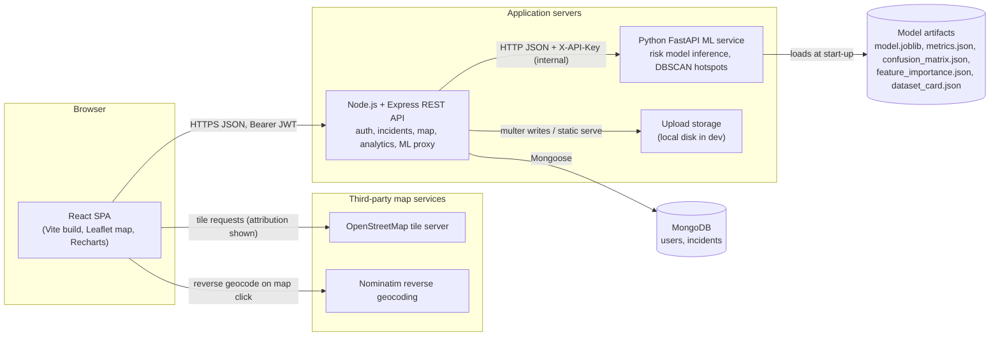
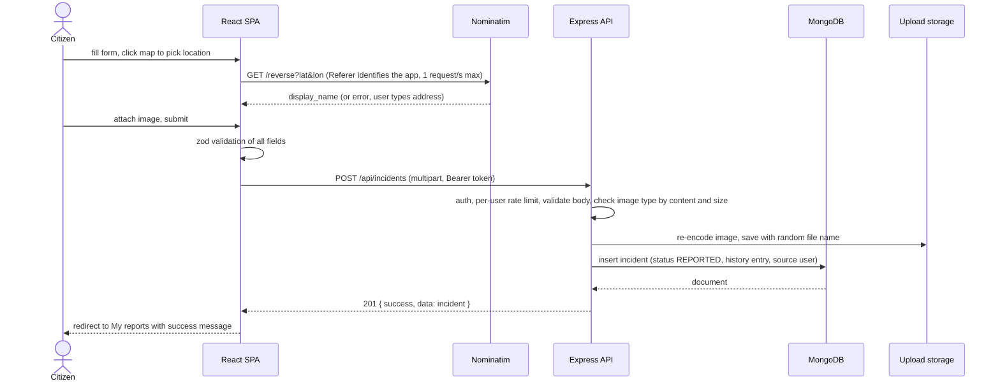
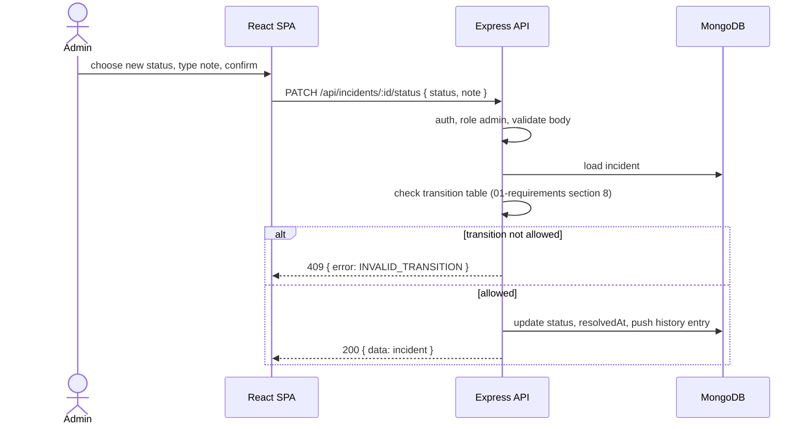
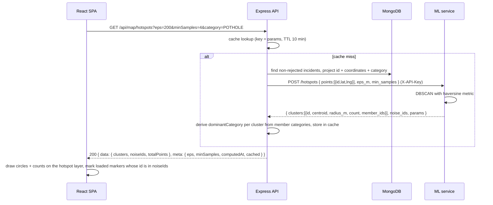
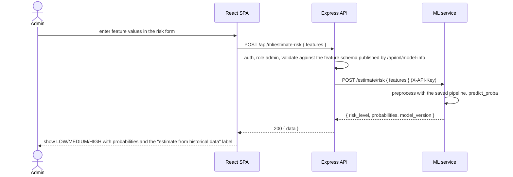
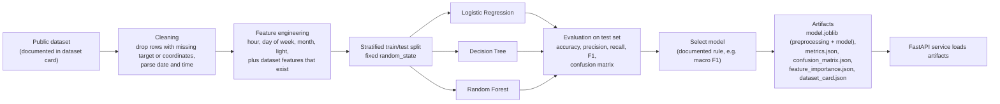
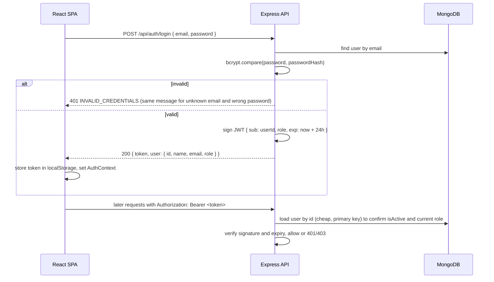
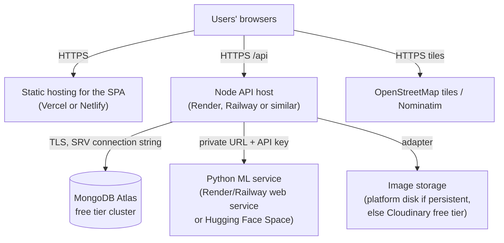

# SmartRoad Phase 1: system architecture

Document 02 of 06, Phase 1 deliverable. Version 0.1, draft for team review, 1 September 2026.

This document describes how the pieces of SmartRoad fit together, why each technology was chosen, and how the GIS, machine-learning and security parts are designed. Requirement IDs (FR-xx, NFR-xx, D-xx) refer to `01-requirements.md`.

## 1. Architecture overview

SmartRoad is a modular three-tier web application with one auxiliary service. There are exactly four deployable units: the React single-page application, the Express API, the MongoDB database and the Python ML service. Nothing else is a separate process. This is deliberately not a microservice architecture; the ML service is separate only because scikit-learn is a Python library and the rest of the system is JavaScript.



Key rules that follow from this picture:

- The browser talks to exactly one backend: the Express API. It never calls the ML service or the database directly.
- The ML service has no database connection. The backend sends it the data it needs (feature values or coordinate lists) and stores nothing on the ML side except the model artifacts produced by training.
- Map tiles and reverse geocoding are fetched by the browser from OpenStreetMap services, because those services are meant to be used that way and it keeps the backend free of proxying tile traffic.
- The upload storage is a directory on the backend host in development. A small storage adapter (`saveImage`, `deleteImage`, `publicUrl`) isolates this so Phase 12 can swap in cloud object storage if the hosting platform has no persistent disk.

## 2. Component responsibilities

| Component | Owns | Does not own |
|---|---|---|
| React SPA | Routing, forms and client-side validation, map rendering, charts, calling the API, storing the JWT, showing loading/empty/error states. | Business rules (status transitions, role checks) beyond hints for the user; any secret. |
| Express API | Authentication and authorisation, validation, incident lifecycle rules, database access, aggregation queries for analytics, file upload handling, calling the ML service and caching its results, error format. | Model training; rendering HTML. |
| MongoDB | Persistent storage of users and incidents, indexes (including 2dsphere) and aggregation execution. | Application logic. |
| ML service | Loading trained artifacts, serving risk estimates, running DBSCAN on coordinate lists, reporting model metadata and metrics. | Any user data storage; authentication of end users (it trusts the backend via a shared API key and is not exposed publicly). |
| Training scripts (offline, in `ml-service/training/`) | Dataset download instructions, cleaning, feature engineering, model comparison, evaluation, artifact export. | Anything at request time. |

### 2.1 Backend internal layering

```
request
  -> middleware (helmet, cors, json, per-IP rate limit, auth, per-user rate limit, role, validate)
  -> route (URL to controller)
  -> controller (parse request, call service, shape response)
  -> service (business rules: transitions, history, aggregation, ML calls)
  -> model (Mongoose schema) / mlClient / storage adapter
```

Controllers never touch Mongoose directly and services never read `req` or write `res`. This keeps unit tests simple (services can be tested with plain objects) and stops files from growing into 500-line route handlers.

### 2.2 Frontend internal structure

Described in `05-frontend-structure.md`. In short: pages compose feature components; an `api/` module wraps axios with the auth header and error normalisation; an `AuthContext` holds the current user; a `useApi` style hook handles loading/error state; no global store beyond React context.

## 3. Main request flows

### 3.1 Citizen reports an incident



### 3.2 Admin changes status



### 3.3 Hotspot layer



### 3.4 Admin requests a risk estimate (research view)



## 4. Technology justification

| Layer | Choice | Alternatives considered | Why this one |
|---|---|---|---|
| Frontend | React 19 with Vite, react-router (D-23) | Next.js, Angular, Vue | The team knows React; Vite gives a fast dev server and simple static build for Vercel or Netlify; Next.js adds server rendering the project does not need. |
| Map | Leaflet + react-leaflet 5 + OpenStreetMap tiles | Google Maps, Mapbox | No API key or billing for tiles at student volume; Leaflet is small and well documented; react-leaflet gives declarative markers and layers. |
| Charts | Recharts | Chart.js, Nivo | React-native components, small API, good enough for bar, pie and line charts. |
| Forms and validation | react-hook-form + zod | Formik + Yup | Less re-rendering, and zod schemas can be shared conceptually with the backend's zod schemas. |
| Backend | Node.js LTS + Express 5 as ES modules (D-21) | NestJS, Fastify, Django | Matches the MERN stack in the abstract; Express is the least ceremony for a REST API; NestJS is heavier than a three-person project needs. |
| Validation (server) | zod | express-validator, Joi | One schema per endpoint, readable errors, same mental model as the frontend. Because every schema accepts only primitive types where primitives are expected, it also blocks MongoDB operator injection, so no separate sanitiser is needed. |
| Database | MongoDB + Mongoose | PostgreSQL + PostGIS | Required by the brief; documents fit incidents with embedded history well; the 2dsphere index covers the geo queries needed (bounding box, near). PostGIS would be stronger for advanced GIS, which is out of scope. |
| Auth | JWT (jsonwebtoken) + bcrypt via `bcryptjs` (D-24) | Sessions with cookies, Passport, Auth0 | Stateless, easy to test, standard in MERN; no third-party account required. |
| Uploads | multer (memory storage) + file-type + sharp + local disk adapter | Cloudinary, S3 | No credentials during development; the type check runs before anything touches the disk; re-encoding strips metadata; the adapter allows switching storage for deployment. |
| Security middleware | helmet, cors, express-rate-limit | Hand-written | Small, standard libraries with clear purposes. |
| ML runtime | Python 3.11, pandas, NumPy, scikit-learn, joblib | TensorFlow, PyTorch | Tabular data with tens of thousands of rows suits classical models; scikit-learn has Logistic Regression, Decision Tree, Random Forest, DBSCAN and metrics in one library (Pedregosa et al., 2011). |
| ML service | FastAPI + uvicorn | Flask | Pydantic request validation, automatic OpenAPI docs and async server for free; roughly the same effort as Flask. |
| Plots for the report | Matplotlib, Seaborn | Plotly | Static images for the project report; no interactivity needed. |
| Tooling | Git, GitHub, VS Code, ESLint, Prettier, Ruff | | Standard and free. |

Library versions are pinned at install time in each phase (package.json and requirements.txt), not guessed here.

## 5. GIS architecture

### 5.1 Data representation

Incident locations are stored as GeoJSON points:

```json
"location": { "type": "Point", "coordinates": [78.4867, 17.3850] }
```

GeoJSON order is `[longitude, latitude]`. This is the number one source of map bugs, so incident objects in the API expose `latitude` and `longitude` as separate named fields and never the raw array; only `GET /api/map/incidents` returns GeoJSON, because Leaflet's `L.geoJSON` consumes it directly and handles the order itself. A 2dsphere index on `location` supports viewport queries with `$geoWithin` and a `$geometry` polygon built from the bounding box (FR-G6; note that the `$box` shorthand only works with the legacy 2d index, so it is not used) and `$near` queries (nearby incidents on the details page, if wanted later).

### 5.2 Map layers (frontend)

| Layer | Source | Notes |
|---|---|---|
| Base tiles | OSM tile URL from `VITE_TILE_URL` (default `https://tile.openstreetmap.org/{z}/{x}/{y}.png`) | Attribution "© OpenStreetMap contributors" always visible. If traffic ever exceeds the OSM tile policy, switch the URL to another provider; no code change. |
| Incident markers | `GET /api/map/incidents` (GeoJSON FeatureCollection) | Circle markers coloured by category or severity (FR-G2); popup from feature properties; optional marker clustering at low zoom (FR-G8). |
| Hotspots | `GET /api/map/hotspots` | One `L.circle` per cluster (centroid, radius), label with count; noise points drawn with a muted outline when the layer is on. Toggled by a layer control. |
| Location picker | Local state on the Report page | Click sets a draggable marker; geolocation button centres and drops the marker; coordinates shown in editable inputs. |

Category colours come from `GET /api/meta/categories`; status and severity colours live in one frontend constants file. The legend component reads the same sources as the markers and charts, so the legend can never disagree with them.

### 5.3 Address lookup

Reverse geocoding uses Nominatim (`/reverse?format=jsonv2&lat=&lon=`) from the browser after a map click, with a debounce that keeps requests under one per second, results cached in memory for the session, and a friendly fallback to manual entry. Browsers do not allow scripts to set `User-Agent`, so the application is identified by the `Referer` header that browsers send automatically, which the Nominatim usage policy accepts. The service URL comes from `VITE_GEOCODE_URL` so it can be switched without a code change, as the policy requires. Forward geocoding (typing an address to find coordinates) is a could-have; the map click covers the requirement.

### 5.4 Why not a heavier GIS stack

PostGIS, GeoServer or ArcGIS would add capabilities such as routing, network analysis and raster layers. None of those is a requirement. MongoDB's geo index plus Leaflet covers markers, filters, bounding boxes and hotspot circles, which is the whole GIS scope of the brief.

## 6. Machine-learning architecture

### 6.1 What the model estimates (and what it does not)

Decision D-15: the risk model is a classifier that maps the context of an incident to one of three risk levels. It is trained on a historical dataset where each record has a known outcome severity, so the three levels are derived from severity classes of that dataset (for example fatal, serious and slight collisions become HIGH, MEDIUM and LOW). The output answers "given these conditions, how serious is an incident likely to be?" It does not answer "will an accident happen here?" and the UI must never say it does.

### 6.2 Pipeline



### 6.3 Candidate features

The final feature set depends on the dataset chosen in Phase 8 (candidates in `06-project-plan.md` section 6). Features are grouped by where they can come from, because a feature that cannot be supplied at inference time is useless for the application even if it helps the offline score.

| Group | Examples | Available at training (public dataset) | Available at inference from SmartRoad data |
|---|---|---|---|
| Temporal | hour of day, day of week, month, weekend flag | Yes (from timestamp) | Yes (from `createdAt` or user-entered time) |
| Lighting | daylight / darkness (derived from time and date, or dataset field) | Yes | Derivable from time |
| Road context | speed limit, road type, urban or rural, junction control | Only if the dataset has them | Only if the admin enters them in the risk form |
| Weather and surface | weather conditions, road surface conditions | Only if the dataset has them | Only if entered manually (SmartRoad does not collect weather) |
| Location | latitude, longitude | Yes | Yes, but see the transfer warning below |
| Local history | count of incidents within 500 m in the 12 months before the record's own timestamp (research model only) | Yes, if computed only from records that are earlier in time and inside the same training fold, otherwise it leaks the target | Not used in the shipped model: it is a geography proxy on a different scale |

Transfer warning: a model trained on coordinates from one country learns the geography of that country. Feeding it Hyderabad coordinates is meaningless. The decision taken now (D-15, D-16, risk 1 in `06-project-plan.md`) is that the model the application calls never uses raw latitude, longitude or the local-history proxy. Phase 8 therefore trains two variants: a research model with every useful feature, reported in the project report for the feature-importance discussion, and the shipped model with transferable features only (temporal, lighting and any road or weather context an admin can type into the form). The ML research view names the shipped model's features and its metrics separately from the research model's, so nobody mistakes one for the other.

### 6.4 Model comparison and evaluation protocol

- Stratified 80/20 split with a fixed `random_state`; optionally 5-fold stratified cross-validation on the training part for hyper-parameter choices.
- Baselines first: majority-class and a simple Logistic Regression. Then a Decision Tree (interpretable) and a Random Forest (Breiman, 2001). Gradient boosting (XGBoost) only if time permits; it is listed in the abstract as an option, not a promise.
- Metrics: accuracy, macro and per-class precision, recall and F1, confusion matrix. Macro F1 is the selection metric because the classes are imbalanced and the minority (HIGH) class matters most.
- Imbalance handling: `class_weight="balanced"` as the first choice (no synthetic data), random undersampling of the majority class as a second experiment, and the report shows both. Stratified splitting is always used.
- Feature importance from the Random Forest (impurity-based, plus permutation importance on the test set as the more trustworthy measure).
- Every number in the ML view and in the report is read from `metrics.json` written by the training script. If a metric is not in that file, it is not shown.

### 6.5 Serving

The FastAPI service loads `model.joblib` (a scikit-learn Pipeline that includes preprocessing) and the JSON artifacts at start-up and exposes:

| Endpoint | Purpose |
|---|---|
| `GET /health` | Liveness, `model_loaded`, `model_version`. |
| `GET /model/info` | Dataset card, model name, training date, feature schema (names, types, allowed values), metrics, confusion matrix, feature importance, and the research-model comparison table. |
| `POST /estimate/risk` | Feature values in, `risk_level` + probabilities out. Rejects unknown or out-of-range values using the feature schema. Named "estimate" on purpose (NFR-13). |
| `POST /hotspots` | Coordinate list in, DBSCAN clusters out. |

The backend proxies `model/info` and `estimate/risk` under `/api/ml/*` for admins only and adds caching for `model/info`. The service requires `X-API-Key` matching `ML_SERVICE_API_KEY` and binds to a private address in deployment.

### 6.6 Separation of research view and citizen UI

Admins get the ML research view (dataset, preprocessing, model, metrics, confusion matrix, feature importance, risk form). Citizens never see it. Whether a per-incident risk label appears on incident details is decided in Phase 8 (FR-ML7); if it does, it is labelled "estimated from historical data" with the model version.

## 7. Hotspot detection design

DBSCAN (Ester, Kriegel, Sander and Xu, 1996) is used because it does not need the number of clusters in advance, finds clusters of any shape, and explicitly labels sparse points as noise, which is exactly the "isolated report versus recurring problem area" distinction the map needs.

- Input: `[lat, lng]` of non-rejected incidents, optionally filtered by category and date range.
- Distance: haversine (scikit-learn `DBSCAN(metric="haversine")` on radians), with `eps` given in metres and converted to radians by dividing by the Earth radius (6,371,000 m).
- Parameters: defaults `eps = 200 m`, `min_samples = 4` for demo data, adjustable from the admin UI within safe bounds (50 to 2,000 m; 3 to 20 points). The choice of `eps` is documented with a sorted k-distance plot, as the original paper recommends (with k = 4 for two-dimensional data).
- Output per cluster from the ML service: id, centroid (mean of member coordinates), radius (maximum haversine distance from the centroid to a member, floored at 30 m for visibility), member count, member incident ids. Plus the list of noise ids. The backend adds `dominantCategory` per cluster by looking up the member ids in the incidents it already fetched; the ML service never sees categories.
- The hotspot request uses the same category and date filters as the marker request on the same page, so the frontend can mark noise points by matching `noiseIds` against markers it has already loaded; ids that are not loaded are ignored.
- The UI and documentation call these "clusters of reported incidents". They describe where reports are dense; they are not an output of the risk classifier and are not weighted by severity in this version.

Small-data behaviour: with fewer than `min_samples` points the service returns zero clusters and the UI says "not enough data for hotspots" (FR-H5).

## 8. Security architecture

### 8.1 Authentication and authorisation flow



### 8.2 Controls by requirement

| Requirement from the brief | Control | Where |
|---|---|---|
| Password hashing | bcrypt, cost 10 (raise to 12 if login latency allows); never log passwords; passwords capped at 72 characters because bcrypt ignores the rest | `User.hashPassword(plain)` static called by the auth service; the schema stores only `passwordHash` |
| JWT authentication | `jsonwebtoken`, HS256, secret from `JWT_SECRET` (at least 32 random bytes), expiry from `JWT_EXPIRES_IN`; the middleware loads the user by id on every request so a deactivated account (`isActive: false`) is rejected before its token expires | `auth` middleware |
| Role-based authorisation | `requireRole("admin")` middleware on admin routes; ownership checks in services for citizen edits | routes and services |
| Protected admin routes | `GET /api/incidents` (full list), `PATCH /api/incidents/:id/status`, `PATCH /api/incidents/:id/priority`, `DELETE /api/incidents/:id`, `/api/analytics/summary`, `/breakdown`, `/timeline`, `/api/ml/*` and `/api/map/hotspots` require admin (hotspots may be opened to citizens later). `/api/analytics/public` needs no token; `/api/analytics/mine` and `/api/incidents/mine` need any valid token. | routes |
| Input validation | zod schemas per endpoint for body, params and query; unknown fields stripped; ids checked as ObjectId; strings only where strings are expected, which also blocks operator injection | `validate` middleware |
| Safe file upload | multer with memory storage and a 5 MB limit, so nothing is written before the check; allow-list of MIME types checked by magic bytes (`file-type`); every accepted image re-encoded with `sharp` (JPEG or WebP output), which drops EXIF data including GPS tags; random file names; files served statically with no execution | upload middleware and storage adapter |
| Environment variables for secrets | `dotenv` in development, platform variables in deployment; `.env` in `.gitignore`; `.env.example` committed | all services |
| CORS | `cors` with an allow-list from `CORS_ORIGIN` (comma-separated) | app setup |
| Error handling | central error middleware; known errors map to 4xx with codes; unknown errors log the stack server-side and return a generic 500 without details | app setup |
| Extra hardening | `helmet` headers with `crossOriginResourcePolicy: { policy: "cross-origin" }` on `/uploads` (helmet's default `same-origin` would make the browser refuse images loaded from the API origin); `express-rate-limit` on `POST /api/auth/login` and `POST /api/auth/register` (for example 10 attempts per 15 minutes per IP), a per-user limit on `POST /api/incidents`, and a looser global limit; `app.set("trust proxy", 1)` in deployment so limits see the client address rather than the platform proxy; request body size limit; HTTPS provided by the hosting platform | app setup |
| ML service isolation | Not reachable from the internet in deployment; requires `X-API-Key`; only the backend knows its URL | ML service and deployment config |

### 8.3 Token storage trade-off (D-17)

Storing the JWT in `localStorage` means a cross-site-scripting bug could read it. Mitigations: React escapes rendered text by default, no `dangerouslySetInnerHTML`, no third-party scripts on the pages, a Content-Security-Policy header set by the static host that serves the SPA (Vercel or Netlify headers configuration, allowing the tile and geocoding hosts; helmet on the API cannot protect the SPA document because the API only serves JSON), short token life (24 hours) and a logout that deletes the token. The alternative, an `httpOnly` cookie, would remove the XSS exposure but adds CSRF protection and cookie-domain configuration across two hosting providers; the team can switch in Phase 12 if the reviewers prefer it. Either way the server, not the browser, decides what a role is allowed to do.

### 8.4 Threats considered and accepted limits

| Threat | Handling |
|---|---|
| Brute-force login | Rate limiting, bcrypt cost, identical error for unknown user and wrong password. |
| Privilege escalation by editing the client | Roles come from the signed token and are checked on the server; the client role is only used to hide menus. |
| Spam or abusive reports | Registration required, rate limit on `POST /api/incidents` (for example 20 per hour per user), admin rejection with reason, admin delete. No CAPTCHA in this version. |
| Malicious upload | Type check by content, size limit, random name, no execution, optional re-encoding. |
| NoSQL injection | zod validation that accepts only primitive types for every input, so an object such as `{ "$gt": "" }` never reaches a query (D-21). |
| Leaking reporter identity | Reporter fields are stripped from responses for non-admins in the incident serializer, not by the frontend. |
| Secret in git | `.gitignore`, `.env.example`, a pre-commit reminder in the README. |
| Not covered | DDoS, account recovery by email (no email provider), audit of admin actions beyond incident history, two-factor authentication. Listed as limitations. |

## 9. Deployment architecture (proposal, to be verified in Phase 12)



Nothing in this diagram assumes a specific free tier. Pricing, sleep behaviour of free web services, disk persistence and region availability change; Phase 12 checks the official documentation of each provider on the day of deployment and records the findings. Development runs everything on one laptop: Vite dev server on 5173, Express on 5000, MongoDB locally or Atlas, FastAPI on 8000.

## 10. Research foundation versus implementation choices

The five references currently in the project are real papers and are used as follows. Only the middle three are directly implemented.

| Reference | Role in SmartRoad |
|---|---|
| Guanetti, Kim and Borrelli (2018), "Control of Connected and Automated Vehicles: State of the Art and Future Challenges", Annual Reviews in Control (arXiv:1804.03757) | Background on intelligent transportation systems and how road infrastructure, cloud data and historical data feed planning. Cited as context and as future scope (connected vehicles, live traffic); nothing from it is implemented. |
| Breiman (2001), "Random Forests", Machine Learning 45(1):5-32 | Foundational: the risk classifier's strongest candidate model, the out-of-bag idea, variable importance by permutation. Implemented through scikit-learn's `RandomForestClassifier`. |
| Pedregosa et al. (2011), "Scikit-learn: Machine Learning in Python", JMLR 12:2825-2830 | Implementation choice: the library used for all models, metrics, cross-validation and DBSCAN. |
| Ester, Kriegel, Sander and Xu (1996), "A Density-Based Algorithm for Discovering Clusters in Large Spatial Databases with Noise", KDD-96 | Foundational: hotspot detection algorithm, the k-distance heuristic for `eps`, and the notion of noise points. Implemented through scikit-learn's `DBSCAN`. |
| Krizhevsky, Sutskever and Hinton (2012), "ImageNet Classification with Deep Convolutional Neural Networks", NIPS 2012 | Future scope only: automatic hazard detection from uploaded photos would use convolutional networks. Not implemented; SmartRoad stores photos for human verification. |

The literature survey in Phase 13 should add peer-reviewed work on Web-GIS incident management and on crash-severity classification with tree ensembles. Those papers will be located and read at that time; none is cited here because none has been verified yet.

## 11. Cross-cutting conventions

- Enumerations from `01-requirements.md` section 7 are defined once per service (`backend/src/config/enums.js`, `frontend/src/constants/enums.js`, `ml-service/app/constants.py`) and the backend serves them through `/api/meta/*` so the frontend can verify it is in sync at start-up.
- Timestamps are stored and transmitted in UTC ISO 8601; the UI formats them in the browser's locale (Asia/Kolkata for the team).
- Coordinates: API fields `latitude` and `longitude` as numbers with at most 6 decimals; storage as GeoJSON.
- Ids: MongoDB ObjectId strings; never sequential integers in URLs.
- Logging: `morgan` in development, JSON lines in production with request id, no request bodies logged.
