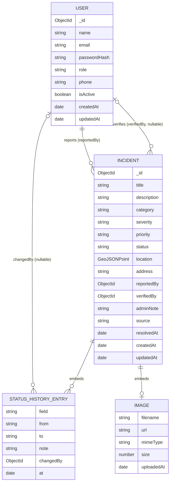

# SmartRoad Phase 1: database schema

Document 03 of 06, Phase 1 deliverable. Version 0.1, draft for team review, 1 September 2026.

MongoDB with Mongoose. Two collections are enough for the whole project: `users` and `incidents`. Status history is embedded in the incident because it is always read together with the incident, is small (a handful of entries) and is never queried on its own. Categories live in code (decision D-13). Model artifacts live on the ML service's disk, not in the database.

## 1. Entity relationship diagram



## 2. `users` collection

| Field | Type | Rules |
|---|---|---|
| `_id` | ObjectId | Generated. |
| `name` | String | Required, trimmed, 2 to 80 characters. |
| `email` | String | Required, unique, lowercased, trimmed, valid email format. Unique index. |
| `passwordHash` | String | Required. Never returned by the API (`select: false`). The schema has no plain `password` path; the auth service calls the static `User.hashPassword(plain)` (bcrypt) and stores the result, both at registration and at password change. |
| `role` | String enum `citizen`, `admin` | Required, default `citizen`. Cannot be set through the registration endpoint (the service ignores any `role` in the body). |
| `phone` | String | Optional, 10 to 15 digits with optional leading `+`. |
| `isActive` | Boolean | Default `true`. Set to `false` by the `scripts/deactivateUser.js` script; the auth middleware loads the user on every request, so a deactivated account is rejected immediately even with a valid token. Used instead of deleting users so incident references stay valid. |
| `createdAt`, `updatedAt` | Date | Mongoose timestamps. |

Indexes: `{ email: 1 }` unique.

Methods: `comparePassword(plain)` returns a Promise<boolean>. Statics: `hashPassword(plain)` and `findByEmailWithPassword(email)`, which selects the hash for login only.

Serialisation: `toJSON` removes `passwordHash` and `__v`, renames `_id` to `id`.

## 3. `incidents` collection

| Field | Type | Rules |
|---|---|---|
| `_id` | ObjectId | Generated. |
| `title` | String | Required, trimmed, 5 to 120 characters. |
| `description` | String | Required, trimmed, 10 to 2000 characters. |
| `category` | String enum (keys from `config/categories.js`) | Required. Validation reads the current key list at runtime so adding a category needs no schema change. |
| `severity` | String enum `LOW`, `MEDIUM`, `HIGH` | Required. Set by the reporter. |
| `priority` | String enum `LOW`, `MEDIUM`, `HIGH`, `CRITICAL` or `null` | Default `null` (unassigned). Only admins set it. |
| `status` | String enum `REPORTED`, `UNDER_REVIEW`, `VERIFIED`, `IN_PROGRESS`, `RESOLVED`, `REJECTED` | Required, default `REPORTED`. Changed only through the status service, which enforces transitions. |
| `location` | GeoJSON Point `{ type: "Point", coordinates: [lng, lat] }` | Required. Longitude -180 to 180, latitude -90 to 90. 2dsphere index. |
| `address` | String | Optional, trimmed, up to 300 characters. From reverse geocoding or typed. |
| `image` | Sub-document `{ filename, url, mimeType, size, uploadedAt }` or `null` | Optional. `filename` is the server-generated random name; `url` is the public path; `mimeType` one of `image/jpeg`, `image/png`, `image/webp`; `size` in bytes, at most 5,242,880. |
| `reportedBy` | ObjectId ref `User` | Required. Immutable after creation. |
| `verifiedBy` | ObjectId ref `User` | Set when status first becomes VERIFIED; otherwise `null`. |
| `adminNote` | String | Optional, up to 1000 characters. The most recent admin note (for example the rejection reason), copied from the latest history entry that carried a note; cleared when a rejected incident is reconsidered. Every note is visible to the reporter (FR-R8); there are no internal notes. |
| `statusHistory` | Array of sub-documents (section 3.1) | Starts with one entry `{ field: "status", from: null, to: "REPORTED" }` created with the incident. Append-only. |
| `source` | String enum `user`, `seed` | Default `user`. `seed` marks demo data (FR-S4). |
| `resolvedAt` | Date or `null` | Set when status becomes RESOLVED, cleared on reopen. |
| `createdAt`, `updatedAt` | Date | Mongoose timestamps. `createdAt` is the reporting time used for all time-based analytics. |

### 3.1 `statusHistory` entry

| Field | Type | Rules |
|---|---|---|
| `field` | String enum `status`, `priority` | Which attribute changed. |
| `from` | String or `null` | Previous value. |
| `to` | String | New value. |
| `note` | String | Optional, up to 1000 characters. Required by the service when `to` is `REJECTED`. |
| `changedBy` | ObjectId ref `User` or `null` | The admin who made the change; `null` for the initial entry created by the reporter's submission. |
| `at` | Date | Default now. |

### 3.2 Virtuals and the serializer

- Virtuals `latitude` and `longitude` read from `location.coordinates[1]` and `[0]`.
- The incident serializer outputs `id`, `latitude` and `longitude` and drops the raw `location` object, so incident objects in the API never expose the `[lng, lat]` array. Only `GET /api/map/incidents` returns GeoJSON, built by the map service from the same documents.
- Privacy is applied by the serializer in the service layer, not by the schema. The single source of truth for what each viewer receives (`reportedBy`, `verifiedBy`, `adminNote`, history notes and `changedBy`) is the table in `04-api-contract.md` section 5.1.

### 3.3 Indexes

| Index | Purpose |
|---|---|
| `{ location: "2dsphere" }` | Bounding-box and near queries for the map and hotspot input. |
| `{ status: 1, createdAt: -1 }` | Admin lists filtered by status, newest first; dashboard counts. |
| `{ category: 1, createdAt: -1 }` | Category filters and analytics. |
| `{ reportedBy: 1, createdAt: -1 }` | My reports list and citizen counts. |
| `{ priority: 1, status: 1 }` | High-priority open incidents. |
| `{ createdAt: -1 }` | Timeline analytics and default sort. |

Admin free-text search (FR-M1) uses a case-insensitive regular expression over `title`, `description` and `address` (D-22) rather than a text index, because substring matching is what users expect and the collection is small. Sorting by `priority` or `severity` in rank order uses an aggregation `$switch` that maps the enum to a number; no rank field is stored.

Expected volume for the project is under 10,000 incidents, so these indexes are more than enough and no sharding or archiving is planned.

## 4. Sample documents

### 4.1 User

```json
{
  "_id": "66d5a1f0c2b7a4e8f1a2b3c4",
  "name": "Priya Sharma",
  "email": "priya@example.com",
  "passwordHash": "$2b$10$...",
  "role": "citizen",
  "phone": "+919876543210",
  "isActive": true,
  "createdAt": "2026-09-14T09:12:33.000Z",
  "updatedAt": "2026-09-14T09:12:33.000Z"
}
```

### 4.2 Incident (after verification and priority assignment)

```json
{
  "_id": "66d5a2b8c2b7a4e8f1a2b3d0",
  "title": "Deep pothole near Hitec City flyover",
  "description": "About 40 cm wide pothole on the left lane just after the flyover exit, two-wheelers swerving into the next lane.",
  "category": "POTHOLE",
  "severity": "HIGH",
  "priority": "HIGH",
  "status": "VERIFIED",
  "location": { "type": "Point", "coordinates": [78.3814, 17.4483] },
  "address": "Hitec City Main Road, Madhapur, Hyderabad",
  "image": {
    "filename": "3f9c2e1a7b8d4c5e.jpg",
    "url": "/uploads/3f9c2e1a7b8d4c5e.jpg",
    "mimeType": "image/jpeg",
    "size": 734221,
    "uploadedAt": "2026-09-14T10:02:11.000Z"
  },
  "reportedBy": "66d5a1f0c2b7a4e8f1a2b3c4",
  "verifiedBy": "66d59f10c2b7a4e8f1a2b3a1",
  "adminNote": "Confirmed by site photo. Scheduled for patching.",
  "statusHistory": [
    { "field": "status", "from": null, "to": "REPORTED", "note": null, "changedBy": null, "at": "2026-09-14T10:02:11.000Z" },
    { "field": "status", "from": "REPORTED", "to": "UNDER_REVIEW", "note": null, "changedBy": "66d59f10c2b7a4e8f1a2b3a1", "at": "2026-09-14T15:40:00.000Z" },
    { "field": "status", "from": "UNDER_REVIEW", "to": "VERIFIED", "note": "Confirmed by site photo. Scheduled for patching.", "changedBy": "66d59f10c2b7a4e8f1a2b3a1", "at": "2026-09-15T08:05:00.000Z" },
    { "field": "priority", "from": null, "to": "HIGH", "note": null, "changedBy": "66d59f10c2b7a4e8f1a2b3a1", "at": "2026-09-15T08:05:30.000Z" }
  ],
  "source": "user",
  "resolvedAt": null,
  "createdAt": "2026-09-14T10:02:11.000Z",
  "updatedAt": "2026-09-15T08:05:30.000Z"
}
```

The coordinates above are illustrative and will be replaced by checked locations when the seed script is written.

## 5. Mongoose schema sketch

Final code is written in Phase 2; this sketch fixes names and options.

```js
// backend/src/models/Incident.js (sketch)
const statusHistoryEntrySchema = new Schema({
  field: { type: String, enum: ["status", "priority"], required: true },
  from: { type: String, default: null },
  to: { type: String, required: true },
  note: { type: String, maxlength: 1000, default: null },
  changedBy: { type: Schema.Types.ObjectId, ref: "User", default: null },
  at: { type: Date, default: Date.now },
}, { _id: false });

const incidentSchema = new Schema({
  title: { type: String, required: true, trim: true, minlength: 5, maxlength: 120 },
  description: { type: String, required: true, trim: true, minlength: 10, maxlength: 2000 },
  category: { type: String, required: true, validate: (v) => CATEGORY_KEYS.includes(v) },
  severity: { type: String, enum: SEVERITIES, required: true },
  priority: { type: String, enum: [...PRIORITIES, null], default: null },
  status: { type: String, enum: STATUSES, default: "REPORTED" },
  location: {
    type: { type: String, enum: ["Point"], required: true },
    coordinates: { type: [Number], required: true }, // [lng, lat]
  },
  address: { type: String, trim: true, maxlength: 300, default: "" },
  image: { type: imageSchema, default: null },
  reportedBy: { type: Schema.Types.ObjectId, ref: "User", required: true, immutable: true },
  verifiedBy: { type: Schema.Types.ObjectId, ref: "User", default: null },
  adminNote: { type: String, maxlength: 1000, default: null },
  statusHistory: { type: [statusHistoryEntrySchema], default: [] },
  source: { type: String, enum: ["user", "seed"], default: "user" },
  resolvedAt: { type: Date, default: null },
}, { timestamps: true });

incidentSchema.index({ location: "2dsphere" });
incidentSchema.index({ status: 1, createdAt: -1 });
incidentSchema.index({ category: 1, createdAt: -1 });
incidentSchema.index({ reportedBy: 1, createdAt: -1 });
incidentSchema.index({ priority: 1, status: 1 });
incidentSchema.index({ createdAt: -1 });
```

## 6. Aggregation queries the analytics module will need

Written here so the schema is checked against them.

| Endpoint | Pipeline sketch |
|---|---|
| Summary counts | `$match` (date range, optional `source`), `$group` by `status` with `$sum: 1`; high-priority open = `$match { priority: { $in: ["HIGH","CRITICAL"] }, status: { $nin: ["RESOLVED","REJECTED"] } }` then `$count`. |
| By category / status / priority | `$match`, `$group` by the field, `$sort` by count. `null` priority is reported as `"UNASSIGNED"` by the service. |
| Timeline | `$match`, `$group` by `$dateTrunc: { date: "$createdAt", unit: "day" | "week" | "month", timezone: "Asia/Kolkata" }`, `$sort` by date, gaps filled by the service. |
| Citizen counts | Same as summary with `$match { reportedBy: userId }`. |
| Map incidents | `find` with filters plus, when a bbox is given, `location: { $geoWithin: { $geometry: { type: "Polygon", coordinates: [[[minLng, minLat], [maxLng, minLat], [maxLng, maxLat], [minLng, maxLat], [minLng, minLat]]] } } }` (the `$box` shorthand only works with the legacy 2d index, so the polygon form is required for 2dsphere); projection of id, title, category, severity, status, priority, createdAt, address, source, location. |
| Hotspot input | `find` non-rejected with projection `{ _id: 1, location: 1, category: 1 }`, optional category and date filters, hard cap of 20,000 points; the category is used by the backend to compute each cluster's dominant category. |

`$dateTrunc` needs MongoDB 5.0 or later, which Atlas and current local installs provide.

## 7. Seed data plan (implemented in Phase 2, extended in Phase 4)

- One admin from `SEED_ADMIN_EMAIL` and `SEED_ADMIN_PASSWORD`; three demo citizens with obviously fake names.
- 60 to 80 demo incidents with `source: "seed"` spread across Hyderabad locations that the team checks on a map (Hitec City, Gachibowli, Kukatpally, Secunderabad, Ameerpet, Banjara Hills, LB Nagar, Uppal, Mehdipatnam and Charminar areas), all categories represented, dates spread over the previous six months, a mix of statuses and priorities, several deliberately placed within 200 m of each other so DBSCAN has something to find, and a few isolated points that should be labelled noise.
- The seed script is idempotent: it deletes documents with `source: "seed"` before inserting, and never touches `source: "user"` records.
- A separate `--load N` mode generates N additional random seed incidents inside the Hyderabad bounding box (also `source: "seed"`) for performance checks such as the Phase 6 exit criterion of 1,000 markers; it is never used for the curated demo set.
- The UI shows a "Demo data" tag on seed incidents so nobody mistakes them for real reports, and public statistics exclude them (FR-D5).

## 8. What is deliberately not modelled

- Separate `categories` collection (D-13), `notifications` collection (D-11), `comments` (out of scope), `assignments` to crews (out of scope), `ml_predictions` per incident (decided in Phase 8; if added it will be a small sub-document `{ riskLevel, probabilities, modelVersion, at }` on the incident, not a collection).
