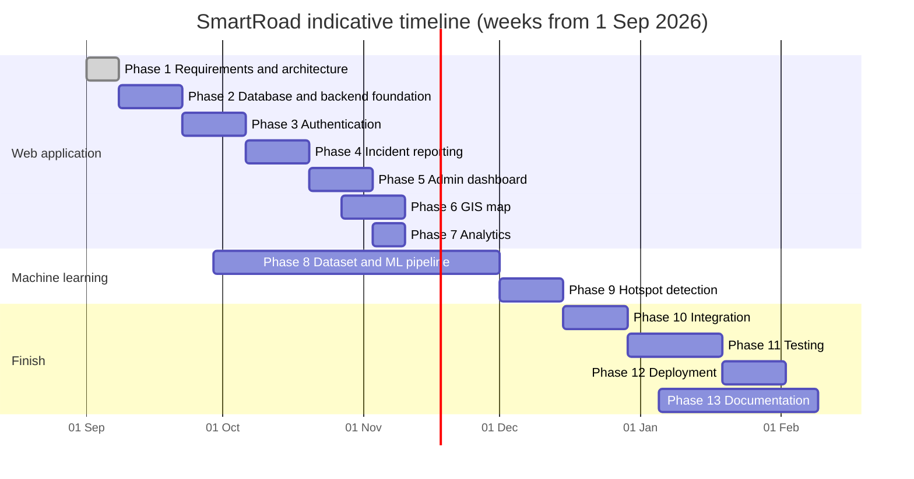
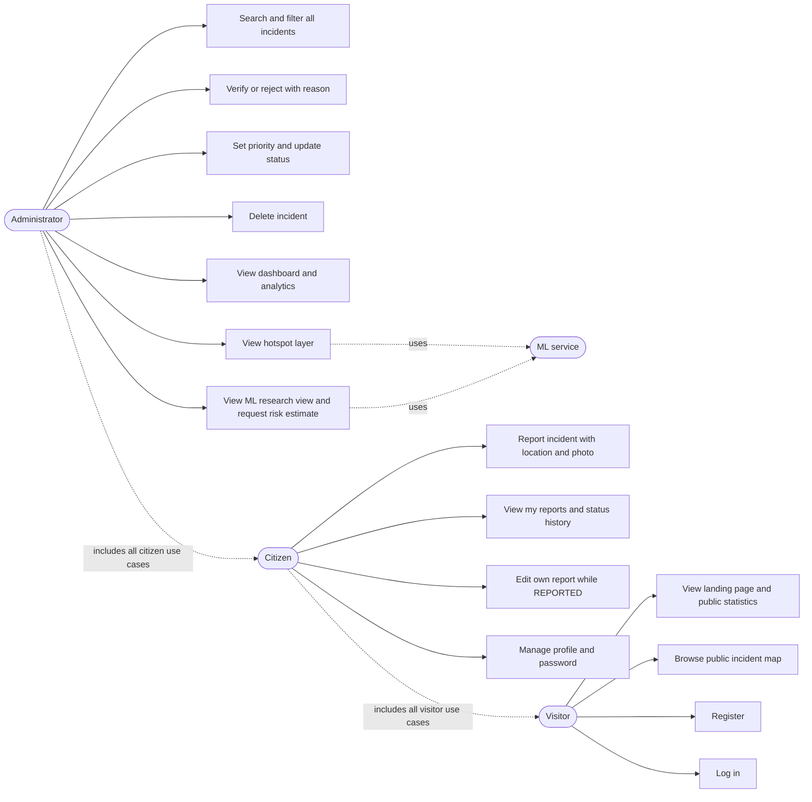
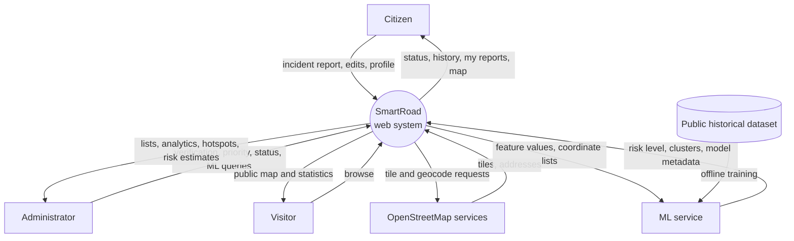

# SmartRoad Phase 1: project plan

Document 06 of 06, Phase 1 deliverable. Version 0.1, draft for team review, 1 September 2026.

Covers the repository layout, dependencies, the thirteen development phases with exit criteria, the team responsibility matrix, risks, dataset requirements with verified candidates, and an effort estimate.

## 1. Repository layout

```
smartroad/
  README.md                 # overview, phase status, how to run (filled in from Phase 2)
  .gitignore
  .editorconfig
  docs/
    01-requirements.md
    02-architecture.md
    03-database-schema.md
    04-api-contract.md
    05-frontend-structure.md
    06-project-plan.md
    diagrams/               # rendered SVG exports of the Mermaid diagrams (Phase 1 drafts now, regenerated in Phase 13)
    report/                 # project report chapters (Phase 13)
    presentation/           # abstract-review slides (Phase 13)
  frontend/                 # React + Vite app (layout in 05-frontend-structure.md)
  backend/
    package.json
    .env.example
    src/
      server.js             # start-up: env check, DB connect, listen
      app.js                # express app: middleware, routes, error handler
      config/
        env.js              # reads and validates environment variables
        db.js               # mongoose connection
        categories.js       # category keys, labels, colours (D-13)
        enums.js            # severities, priorities, statuses, transitions
      middleware/
        auth.js requireRole.js validate.js upload.js errorHandler.js rateLimit.js
      models/
        User.js Incident.js
      routes/
        index.js auth.routes.js users.routes.js incidents.routes.js analytics.routes.js map.routes.js ml.routes.js meta.routes.js health.routes.js
      controllers/
        auth.controller.js users.controller.js incidents.controller.js analytics.controller.js map.controller.js ml.controller.js meta.controller.js
      services/
        auth.service.js incident.service.js incidentStatus.service.js analytics.service.js map.service.js ml.service.js
      validation/
        auth.schema.js incident.schema.js query.schema.js
      lib/
        storage/            # local disk adapter now, cloud adapter later
        mlClient.js         # HTTP client for the ML service with timeout and API key
        cache.js            # small in-memory TTL cache
        serializers.js      # incident privacy variants
        errors.js           # AppError and error codes
      scripts/
        seed.js             # admin + curated demo data (idempotent), plus --load N for performance checks
        createAdmin.js
        deactivateUser.js
    tests/
      unit/ integration/
    uploads/                # git-ignored
  ml-service/
    requirements.txt
    .env.example
    app/
      main.py               # FastAPI app, routers, API key dependency
      constants.py          # risk classes, defaults
      schemas.py            # pydantic request/response models
      model_loader.py       # loads artifacts at start-up
      routers/
        health.py model.py estimate.py hotspots.py
      services/
        risk.py hotspots.py
    training/
      README.md             # how to download the dataset and run the pipeline
      01_explore.ipynb      # exploration (Colab-friendly)
      prepare_data.py       # cleaning and feature engineering
      train_models.py       # LR, DT, RF comparison, metrics, artifacts
      evaluate.py           # confusion matrix, permutation importance, plots
      config.yaml           # dataset path, features, target mapping, random_state
    artifacts/              # model.joblib, metrics.json, ... (git-ignored except a small README)
    tests/
  dataset/
    README.md               # dataset card template and rules (no raw data in git)
    scripts/                # download helpers
  screenshots/              # for README and report (Phase 13)
```

## 2. Dependencies (purpose, pinned at install time)

Backend (Express 5, ES modules, D-21; installed in Phase 2, majors in D-25): express, mongoose, bcryptjs (D-24), jsonwebtoken, zod, helmet, cors, express-rate-limit, morgan, axios (ML client). Added in Phase 4: multer (a current 2.x release with the published denial-of-service advisories fixed; check the advisory list at install), file-type (ESM only, hence the module choice), sharp (re-encoding is mandatory, not optional). Dev: eslint, prettier, vitest, supertest, mongodb-memory-server. No dotenv and no nodemon: `node --env-file=.env --watch` covers both.

Frontend (React 19, D-23): react, react-dom, react-router-dom, axios, leaflet, react-leaflet 5, recharts, react-hook-form, zod, @hookform/resolvers. Optional: leaflet.markercluster. Dev: vite, @vitejs/plugin-react, eslint, prettier, vitest, @testing-library/react.

ML service: fastapi, uvicorn, pydantic, scikit-learn, pandas, numpy, joblib, python-dotenv, pyyaml (for `training/config.yaml`). Training: matplotlib, seaborn, jupyter. Dev: pytest, httpx, ruff.

Exact versions are decided when each service is scaffolded (Phases 2, 3 and 8) and recorded in `package-lock.json` and `requirements.txt`. If the React 19 and react-leaflet 5 pairing fails at install, the fallback is React 18 with react-leaflet 4 (D-23).

## 3. Development phases

Weeks are indicative and start from the week of 1 September 2026; the calendar below spans about 23 weeks because it leaves gaps for internal exams. The team should shift dates to fit the college's review dates and exam weeks; the order, the dependencies and the exit criteria are the fixed part.

| Phase | Scope | Main deliverables | Exit criteria | Weeks |
|---|---|---|---|---|
| 1 | Requirements and architecture | Documents 01 to 06, repo skeleton | Team and guide accept the documents | 1 |
| 2 | Database and backend foundation | Express app, env config, Mongoose models, error handling, health and meta endpoints, seed script with admin, test setup | `npm test` passes; `GET /api/health` reports DB ok; seed creates an admin | 2 to 3 |
| 3 | Authentication | Register, login, me, profile and password endpoints; frontend scaffold with routing, layouts, tokens, login, admin login, registration and Profile pages, auth context, guards | A citizen can register, log in, refresh the page and stay logged in; admin login redirects correctly; rate limit works; profile can be edited | 4 to 5 |
| 4 | Incident reporting | Incident create/mine/get/patch endpoints with upload; Citizen dashboard, Report, Edit, My reports and Incident details pages; curated seed incidents for Hyderabad | A citizen can report with map location and image, see it in My reports with status REPORTED, and edit it while REPORTED | 6 to 7 |
| 5 | Admin dashboard and management | Full list, status, priority, delete endpoints; summary and mine analytics; Admin dashboard (counts), Incident management, admin details page | An admin can move an incident through the lifecycle and the dashboard counts change accordingly | 8 to 9 |
| 6 | GIS map | Map incidents endpoint with bbox polygon query; Map view page with filters, legend, popups; landing page mini map and public stats | Filters combine correctly; 1,000 generated markers (seed `--load 1000`) render smoothly | 9 to 10 |
| 7 | Analytics | Breakdown and timeline endpoints; charts on the dashboard and the Analytics page | Chart values match direct database queries in a test | 10 |
| 8 | ML pipeline | Dataset selection and card; training scripts; artifacts; ML service with model endpoints; backend proxy; ML research view | Metrics in the UI equal `metrics.json`; a written dataset card exists; a risk estimate can be requested | 5 to 13 (parallel, see note) |
| 9 | Hotspot detection | `/hotspots` on the ML service; backend caching; hotspot layer and Hotspot map page | Seed clusters are found; noise points labelled; parameters adjustable | 14 to 15 |
| 10 | Integration | Remove mocks, end-to-end flows, error states, empty states, performance checks, seed polish | No import from `mocks/`; every page handles loading, empty and error | 16 to 17 |
| 11 | Testing | Unit, integration, API, UI, auth, database, ML model, security and user acceptance tests; test-case table with actual results | Test table filled with executed results only | 18 to 20 |
| 12 | Deployment | Provider checks against official docs, environment setup, Atlas, ML hosting, storage adapter, HTTPS, smoke test | Public URL works end to end; deployment notes written | 21 to 22 |
| 13 | Documentation | README, report chapters, UML/ER/DFD diagrams, API docs, ML methodology, results, limitations, future scope, presentation | Report and slides reviewed by the guide | 19 to 23 |

Note on Phase 8: dataset assessment starts in week 5 in parallel with Phases 3 to 7, because finding, downloading and understanding the dataset takes longer than training. Arman owns this track while Balaji and Vivek build the web application. The only thing Phase 8 needs from the web side is the backend proxy, added once Phase 5 is merged.



Dependencies: 3 needs 2; 4 needs 3; 5 and 6 need 4 (they run side by side because one member owns each); 7 needs 5; 9 needs 8 and 6; 10 needs 5, 6, 7, 8 and 9; 11 needs 10; 12 needs 11 (at least the API and auth tests); 13 runs alongside 11 and 12. A phase may start when the previous phase's exit criteria are met on `main`, not before.

## 4. Team responsibility matrix

R = responsible (does the work), S = supports or reviews. Overlap is expected; the matrix says who is accountable, not who is excluded.

| Area | Balaji Lakshmipathi | Vivek Reddy | Arman Koyalkar |
|---|---|---|---|
| Requirements and architecture docs (Phase 1) | R | S | S |
| Backend foundation, models, seed (Phase 2) | R | | S |
| Authentication API | R | | |
| Frontend scaffold, layouts, design tokens, auth pages (Phase 3) | S | R | |
| Incident API and upload (Phase 4) | R | | |
| Report, My reports, details pages (Phase 4) | | R | |
| Admin API: status, priority, analytics summary (Phase 5) | R | | S |
| Admin dashboard and management pages (Phase 5) | | R | |
| Map endpoints and geo indexes (Phase 6) | R | S | |
| Map view, legend, filters, landing page (Phase 6) | | R | |
| Analytics endpoints (Phase 7) | R | | S |
| Charts and Analytics page (Phase 7) | | R | S |
| Dataset selection, dataset card, EDA (Phase 8) | | | R |
| Training scripts, model comparison, artifacts (Phase 8) | | | R |
| ML service (FastAPI) and backend proxy (Phase 8) | S | | R |
| ML research view page (Phase 8) | | R | S |
| DBSCAN endpoint and caching (Phase 9) | S | | R |
| Hotspot layer and Hotspot map page (Phase 9) | | R | S |
| Integration (Phase 10) | R | R | S |
| Testing strategy and test-case table (Phase 11) | S | S | R |
| Deployment (Phase 12) | R | S | S |
| Report, diagrams, references (Phase 13) | R | S | R (ML chapters, literature) |
| Presentation (Phase 13) | R | R | R |
| Project coordination, weekly check-ins, git hygiene | R | | |

## 5. Risks and mitigation

| # | Risk | Likelihood | Impact | Mitigation |
|---|---|---|---|---|
| 1 | No open record-level Indian crash dataset with coordinates; the model is trained on foreign data and cannot be applied to Hyderabad coordinates | High | Medium | Decided up front (D-15, D-16): the shipped model never uses raw coordinates or a local-history proxy; a separate research model may use them for the report only; the ML view states the dataset and its country; hotspots use SmartRoad's own data. |
| 2 | The dataset is heavily imbalanced (few HIGH cases) and metrics look poor | High | Medium | Class weights, stratified splits, macro F1 as the selection metric, honest reporting; the brief explicitly allows a demonstrative pipeline when data is insufficient (FR-ML8). |
| 3 | Scope creep from the fourteen pages and thirteen phases | Medium | High | Must/should/could priorities in `01-requirements.md`; could-haves are cut first; the phase exit criteria are the only definition of done. |
| 4 | Free hosting tiers change or sleep, breaking the demo | Medium | Medium | Verify providers in Phase 12 against official docs; keep a laptop-hosted fallback with a tunnelled URL for the viva; record the exact deployment steps. |
| 5 | Latitude/longitude order bugs between GeoJSON and Leaflet, and the wrong bounding-box operator for the 2dsphere index | High | Low | Incident objects expose named `latitude` and `longitude`; the viewport query uses a `$geometry` polygon (not `$box`); unit tests cover the conversion and the polygon builder; seed data is checked visually on the map. |
| 6 | Image uploads abused or unsafe | Low | Medium | Type check by content, size limit, random names, no execution, admin delete. |
| 7 | Uneven workload if one member is blocked (exams, illness) | Medium | Medium | Every phase has an R and an S; docs 03 and 04 let anyone pick up an endpoint; weekly check-in owned by the lead. |
| 8 | Losing marks for unsupported claims ("AI-powered", "real-time") | Low | High | NFR-13; a grep for banned phrases is part of the Phase 11 checklist. |
| 9 | Nominatim or OSM tile policy limits during a demo with many users | Low | Low | Debounce, caching, low volume; configurable tile URL; the demo has a handful of users. |
| 10 | Secrets committed to GitHub | Medium | High | `.gitignore` from day one, `.env.example` only, a pre-commit note in the README, rotate any leaked secret immediately. |
| 11 | MongoDB free tier limits (storage, connections) | Low | Low | Volume is tiny; indexes keep queries cheap; seed script deletes and re-creates rather than accumulating. |

## 6. Dataset requirements and candidates

### 6.1 What the ML dataset must provide

- Public, with a licence that allows academic use and redistribution of results (not necessarily of the raw data).
- Record-level rows (one per incident), at least several thousand rows after cleaning.
- A severity or outcome field usable as the target with at least three levels, or two levels plus a documented way to derive three.
- Timestamp (date and time) for temporal features.
- Coordinates for the research model and for density features.
- Ideally context fields (weather, road surface, light, speed limit, road type) for the report's feature-importance discussion.
- Documented provenance: who collected it and how.

### 6.2 Candidates checked on 1 September 2026

| Candidate | Publisher and licence | Size and coverage | Fields relevant to SmartRoad | Fit |
|---|---|---|---|---|
| Road Safety Data (STATS19), Great Britain | UK Department for Transport; Open Government Licence v3.0 (as stated in the ropensci `stats19` documentation, checked 1 September 2026; confirm on the DfT release page in Phase 8) | Data from 1979 to 2024; about 104,000 collision records in 2023 according to the same documentation (verify against the DfT release); three tables: collisions (37 columns), casualties (21), vehicles (34) | latitude, longitude, date, time, accident_severity (fatal, serious, slight), weather_conditions, road_surface_conditions, light_conditions, speed_limit, road_type, urban_or_rural_area | Strong. Three severity levels map directly to HIGH/MEDIUM/LOW; rich context fields; permissive licence. Drawbacks: British roads, so only transferable features go into the shipped model; and since 2016 many police forces changed to injury-based severity reporting, so DfT publishes adjusted serious/slight figures. The dataset card must state which years and which severity variable are used so the three classes mean one thing. |
| US-Accidents (Moosavi et al.) | Distributed on Kaggle by Sobhan Moosavi; CC BY-NC-SA 4.0, research and academic use only, citation of the authors' papers requested | Kaggle release covers February 2016 to March 2023 across 49 states with about 7.7 million records; the authors' site describes the earlier 2016 to 2020 release with about 1.5 million records (both figures as published by the distributor, checked 1 September 2026) | Severity (1 to 4), Start_Time, Start_Lat, Start_Lng, weather condition, temperature, visibility, points of interest such as junctions and signals | Good but heavy: the file is large for laptops (sampling needed), severity is an impact-on-traffic scale rather than injury severity, and the non-commercial licence must be stated. |
| Motor Vehicle Collisions, Crashes (New York City) | NYPD via NYC Open Data; public dataset, each row is a crash event from the MV-104AN police report; no formal licence text on the catalog page, NYC Open Data terms apply | Millions of rows since 2012, updated regularly (the catalog page showed a temporary update pause when checked on 1 September 2026) | crash date and time, borough, latitude, longitude, persons injured and killed, contributing factors, vehicle types | Usable. Severity must be derived from injured/killed counts (which creates the three levels but with extreme imbalance); fewer context fields than STATS19. |
| Road Accidents in India (MoRTH annual reports) via data.gov.in and opencity.in | Ministry of Road Transport and Highways; data.gov.in publishes under the Government Open Data License India, opencity lists it as public domain | Aggregated tables only: state-wise, city-wise, cause-wise, road-user-wise counts for 2019 to 2023 | Counts per state, city, collision type, violation; no coordinates, no individual records | Not usable for a record-level classifier. Useful for the report's background (national context) and possibly for a Hyderabad-level comparison figure. |
| "India road accident" datasets on Kaggle | Individual uploaders; provenance and licence vary; several are synthetic or unexplained | Varies | Varies | Avoid unless the uploader documents a verifiable official source. A synthetic dataset presented as real would break the honesty rule. |

Recommendation for Phase 8: start the assessment with STATS19 (most complete, best licence, three-level target). Keep US-Accidents as the alternative if STATS19's context fields turn out to be mostly "unknown" for recent years. Record the final choice, access date and licence in `dataset/README.md` and in the dataset card served by the ML service.

### 6.3 SmartRoad's own incident data

Reports collected through the application are real training data in principle, but during the academic year they will number in the dozens (plus seed data, which must never be used for training). They are used for hotspot detection (which needs no labels) and for the density feature at inference time. The training script is written so that a future team can point it at an export of SmartRoad incidents once there are enough labelled records; the report says this plainly under future scope.

## 7. Estimated implementation complexity

Effort in person-days for one team member at a student pace (about four focused hours per day, two to three days per week). Ranges are estimates, not commitments.

| Module | Complexity | Person-days | Main difficulty |
|---|---|---|---|
| Backend foundation, config, models, seed, tests setup | Low | 4 to 6 | Getting conventions right once (error format, validation, serializers). |
| Authentication (API + pages) | Low | 4 to 6 | Token restore on refresh, guards, rate limiting. |
| Incident reporting (API with upload + three pages + location picker) | Medium | 8 to 12 | Multipart handling, image validation, map picker with two-way coordinate sync, reverse geocoding. |
| Admin management (lifecycle API + dashboard counts + management page + details) | Medium | 8 to 10 | Transition rules with history, privacy variants, table with many filters. |
| GIS map (endpoint + Map view + landing map) | Medium | 6 to 9 | Filters in URL, bbox fetching, legend consistency, performance with many markers. |
| Analytics (aggregations + charts) | Low to medium | 4 to 6 | `$dateTrunc` with timezone, gap filling, chart formatting. |
| ML pipeline (dataset, cleaning, three models, evaluation, artifacts, service, proxy, research view) | High | 15 to 22 | Dataset size and cleaning, imbalance, honest evaluation, feature schema for the form, keeping UI and artifacts in sync. |
| Hotspot detection (DBSCAN endpoint, caching, layer, hotspot map page) | Medium | 5 to 7 | Haversine parameters, eps selection, drawing clusters clearly. |
| Integration and polish | Medium | 6 to 8 | Removing mocks, error and empty states everywhere, responsive fixes. |
| Testing (nine categories, test table) | Medium | 8 to 10 | Writing integration tests with an in-memory MongoDB, UI tests for forms. |
| Deployment | Medium | 4 to 6 | Provider verification, environment variables, storage adapter, ML hosting. |
| Documentation and presentation | Medium | 10 to 14 | Report chapters, diagrams, literature survey, results from real runs. |
| Total | | 82 to 116 person-days | About 27 to 39 days each for three people; at two to three working days a week that is 9 to 20 weeks of work, which fits inside the 23-week calendar in section 3 with room for exams. |

The ML track is the long pole; it starts early (week 5) for that reason.

## 8. Use case overview



## 9. Data flow (level 0 context)



## 10. Testing and deployment pointers

The testing strategy (nine categories and the test-case table format) is written in Phase 11 from the requirement IDs in `01-requirements.md`; each FR-xx becomes at least one test case, and the table is only ever filled with executed results. Deployment (Phase 12) starts by reading the current official documentation of the chosen providers; nothing in this plan assumes a free tier exists.

## 11. What happens after approval

When the team says "Continue" (or "START PHASE 2"), Phase 2 begins with the backend scaffold exactly as described in section 1, the models from `03-database-schema.md`, the health and meta endpoints from `04-api-contract.md`, the seed script with the Hyderabad admin and demo data plan, and the test setup. Frontend work starts in Phase 3 so that the first pages are built against a running API rather than against mocks.
