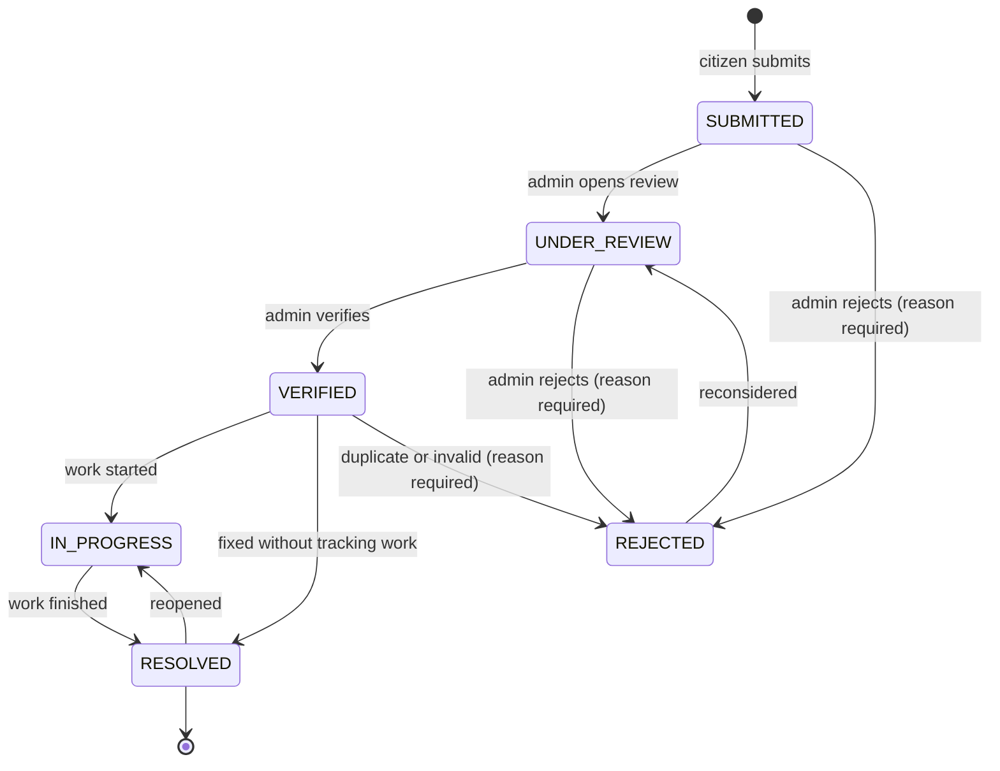

# SmartRoad requirements

This document lists the requirements the delivered system implements. Requirement IDs are stable and are referenced by the tests (`docs/testing.md`). The original Phase 1 analysis, including the decision log that led here, is in `docs/design/01-requirements.md`; decisions taken after it are recorded in section 6 below.

## 1. Scope

In scope: citizen registration and login; admin login; role-based access; incident reporting with category, description, severity, map-picked location and an optional image; server-enforced incident lifecycle; citizen tracking of own reports; public incident map; admin dashboard, incident management, analytics and user management; DBSCAN hotspot analysis; a documented Random Forest risk estimator with a demo dataset; security basics; tests; documentation.

Out of scope (see `docs/future-scope.md`): IoT sensors, dashcams or computer vision; live traffic feeds, WebSockets or push notifications; SMS or email; field-crew assignment; native mobile apps; multi-city tenancy; any claim of predicting individual accidents.

## 2. User roles

| Role | Stored as | Capabilities |
|---|---|---|
| Visitor | none | Landing page, public statistics, public map (reporter identity hidden, rejected reports hidden), register, login. |
| Citizen | `citizen` | Everything a visitor can do, plus report incidents, view and edit own reports while SUBMITTED, track status and history, manage profile and password. |
| Administrator | `admin` | Everything a citizen can do, plus view all incidents with reporter identity, search and filter, verify or reject, set priority, change status, edit and delete, view analytics, GIS and hotspots, run risk estimation, manage users. |

Administrators are never created through the public registration form. The first administrator is created by the seed script from environment variables; more can be added with `npm run create-admin` in `backend/`.

## 3. Functional requirements

Priority M = must have, S = should have. All listed requirements are implemented unless marked otherwise.

### 3.1 Authentication and accounts (FR-A)

| ID | Requirement | Priority |
|---|---|---|
| FR-A1 | A visitor can register with name, email, password and optional phone. Email must be unique; password 8 to 72 characters. | M |
| FR-A2 | A user can log in with email and password and receives a signed JWT (subject = user id, role claim, 24 h expiry by default). | M |
| FR-A3 | Passwords are stored only as bcrypt hashes; the hash is never returned by the API. | M |
| FR-A4 | Protected routes reject requests without a valid, unexpired token. A deactivated account is rejected immediately because the user is loaded on every request. | M |
| FR-A5 | Admin-only routes reject valid tokens whose user is not an administrator. | M |
| FR-A6 | A user can view and update their profile (name, phone) and change their password after supplying the current one. | S |
| FR-A7 | Login and registration are rate-limited per IP. | S |
| FR-A8 | The admin login page uses the same endpoint as citizens and redirects non-admin accounts to the citizen area with an explanation. | M |
| FR-A9 | Logout discards the token in the browser (stateless JWT architecture). | M |

### 3.2 Incident reporting (FR-R)

| ID | Requirement | Priority |
|---|---|---|
| FR-R1 | A citizen submits an incident with title (5 to 120), category (one of ten configured keys), description (10 to 2000), severity (LOW, MEDIUM, HIGH), latitude, longitude and optional address. | M |
| FR-R2 | The location can be chosen by clicking the map, dragging the marker, using browser geolocation or typing coordinates. | M |
| FR-R3 | After a map click the address is filled by reverse geocoding (Nominatim) and remains editable; failure falls back to manual entry. | S |
| FR-R4 | At most one image (JPEG, PNG, WebP, at most 5 MB by default). The server validates type by magic bytes and size, stores the file under a random name, and never trusts the client file name. | M |
| FR-R5 | The form validates inputs before submission with a message per field; the server repeats all validation and returns field-level details. | M |
| FR-R6 | A new incident starts as SUBMITTED, priority unassigned, with the reporter and time recorded and an initial history entry. | M |
| FR-R7 | A citizen sees a paginated, filterable list of their own reports with status, verification state, category, severity, priority and date. | M |
| FR-R8 | A citizen can open a report and see all details, the image, the location on a map and the full status history including admin notes. | M |
| FR-R9 | A citizen can edit their own report (all fields and image) only while it is SUBMITTED. | S |
| FR-R10 | Categories are defined once on the backend and served to the frontend. | M |

### 3.3 Incident management (FR-M)

| ID | Requirement | Priority |
|---|---|---|
| FR-M1 | An admin lists all incidents with filters (status, category, severity, priority including unassigned, source, risk level, date range), substring search over title, description and address, sorting (date, priority, severity, status; priority and severity in rank order) and pagination. | M |
| FR-M2 | An admin sees every field of an incident including reporter name and email, the verifier and the history with actor names. | M |
| FR-M3 | Status changes follow the transition table; invalid moves are rejected with INVALID_TRANSITION and the allowed list. | M |
| FR-M4 | An admin sets or clears priority (LOW, MEDIUM, HIGH, CRITICAL). Priority is never set automatically. | M |
| FR-M5 | Rejecting requires a note; the note is visible to the reporter. | M |
| FR-M6 | Every status or priority change is appended to the incident history with actor, old and new value, note and timestamp. | M |
| FR-M7 | An admin can edit any incident and delete it (with confirmation); deletion removes the image file. | S |
| FR-M8 | RESOLVED sets `resolvedAt`; reopening clears it; the first VERIFIED records the verifier. | M |
| FR-M9 | An admin can list, search and inspect users, deactivate or reactivate them and change roles, but not for their own account. | S |

### 3.4 Map and GIS (FR-G)

| ID | Requirement | Priority |
|---|---|---|
| FR-G1 | Incidents are shown as markers on OpenStreetMap tiles with Leaflet, centred on the configured city. | M |
| FR-G2 | Marker colour encodes category by default and can be switched to severity or status (admins also risk level); a legend explains colours. | M |
| FR-G3 | Marker popups show title, category, severity, status, date and address; signed-in users get a details link; reporter identity is never shown. | M |
| FR-G4 | The map can be filtered by category, status, severity, priority (admin), risk level (admin) and date range; filters combine and live in the URL. | M |
| FR-G5 | Visitors and citizens never see REJECTED incidents on the map; admins can include them. | M |
| FR-G6 | The map requests only incidents inside the viewport (bounding box) once the API reports truncation. | S |
| FR-G7 | The hotspot layer draws each DBSCAN cluster as a circle with its count; noise points are marked differently. | S |
| FR-G8 | Nearby markers are grouped by marker clustering at low zoom levels. | S |
| FR-G9 | Tiles carry the OpenStreetMap attribution; the tile and geocoding URLs are configurable. | M |
| FR-G10 | The map endpoint returns GeoJSON so the GIS layer is reusable by other clients. | M |

### 3.5 Dashboards and analytics (FR-D)

| ID | Requirement | Priority |
|---|---|---|
| FR-D1 | The citizen dashboard shows the user's own counts (total, pending, active, resolved, rejected), the five most recent reports and a prominent report button. | M |
| FR-D2 | The admin dashboard shows total, pending verification, verified, active, resolved, rejected and high-priority open counts, all from aggregation queries. | M |
| FR-D3 | Charts: incidents by category, status, priority, severity and risk level, and incidents over time (day, week, month). | M |
| FR-D4 | The admin dashboard embeds a map with incident distribution and a hotspot toggle. | S |
| FR-D5 | The landing page shows public aggregate figures that exclude rejected and seed records; nothing is shown while loading or on error. | M |
| FR-D6 | Admin analytics accept a date range and a flag to exclude seed records; the page states when seed records are included. | S |
| FR-D7 | The admin dashboard shows the distribution of stored risk estimates with the model version and a demo-model notice. | S |

### 3.6 Machine-learning risk estimation (FR-ML)

| ID | Requirement | Priority |
|---|---|---|
| FR-ML1 | The dataset used for training is documented in a dataset card (`data/README.md`). The delivered card describes a synthetic DEMO dataset and how to replace it with a real one. | M |
| FR-ML2 | A reproducible pipeline loads, validates, explores, preprocesses and splits the data (stratified, fixed seed), trains a majority baseline, Logistic Regression, Decision Tree and Random Forest, and evaluates accuracy, macro and weighted F1, per-class precision, recall and F1, and a confusion matrix on a held-out test set. | M |
| FR-ML3 | Class imbalance is handled with class weights; stratified splitting is always used. | M |
| FR-ML4 | The chosen model (selected by macro F1), metrics, confusion matrix, feature importances (impurity and permutation), baselines and dataset card are saved as artifacts and loaded by the ML service at start-up. | M |
| FR-ML5 | The admin risk page shows dataset information, preprocessing, model summary, metrics, comparison table, confusion matrix, feature importance, class distribution and a form to request an estimate. Every number comes from the artifacts. | M |
| FR-ML6 | Estimates are LOW, MEDIUM or HIGH with class probabilities, a sensitivity-based list of contributing factors, the model version and a disclaimer. | M |
| FR-ML7 | An admin can request an estimate for a stored incident; the feature vector is derived from the incident and assumed values are listed explicitly. Estimates can be refreshed for all incidents and their distribution is shown. | S |
| FR-ML8 | When the pipeline runs on the demo dataset, the UI states it is a demo model and results describe the pipeline, not real roads. | M |
| FR-ML9 | The web application keeps working when the ML service is down; ML panels show an unavailable state. | M |

### 3.7 Hotspot detection (FR-H)

| ID | Requirement | Priority |
|---|---|---|
| FR-H1 | The ML service runs DBSCAN with haversine distance on a coordinate list with configurable `eps` (metres) and `min_samples`. | M |
| FR-H2 | The backend collects non-rejected incident coordinates (optionally filtered), calls the service, and returns clusters with centroid, radius, count, member ids, dominant category and category counts, plus noise ids. | M |
| FR-H3 | Results are cached for ten minutes per parameter set. | S |
| FR-H4 | The UI states that hotspots are density clusters of reported incidents computed with DBSCAN, not an output of the risk model. | M |
| FR-H5 | With fewer than `min_samples` incidents the response has no clusters and the UI says so. | M |

### 3.8 Cross-cutting (FR-S)

| ID | Requirement | Priority |
|---|---|---|
| FR-S1 | List endpoints are paginated (`page`, `limit` max 100) and return totals. | M |
| FR-S2 | All errors use one JSON envelope with a machine-readable code, a message and field-level details where relevant. | M |
| FR-S3 | A health endpoint reports database and ML service connectivity. | S |
| FR-S4 | Seed data carries `source: "seed"`, is labelled in the UI, excluded from public figures and removable with one command. | M |
| FR-S5 | Configuration comes from environment variables documented in `.env.example` files. | M |

## 4. Non-functional requirements

| ID | Category | Requirement |
|---|---|---|
| NFR-1 | Performance | Indexes on status, category, createdAt, reportedBy, priority, risk level and a 2dsphere index on location. List and map endpoints are bounded (pagination, 5000-marker cap with truncation flag). |
| NFR-2 | Performance | The map stays usable with 1000+ markers through clustering and viewport queries. |
| NFR-3 | Security | bcrypt hashing, JWT with a 32+ character secret, server-side role checks, validation on every write, upload type and size checks, helmet headers, restricted CORS, no stack traces in production, secrets only in environment variables, rate limiting. |
| NFR-4 | Availability | Reporting, management, map and analytics work without the ML service. |
| NFR-5 | Usability | Inline validation, loading, empty and error states on every asynchronous view, confirmation on destructive actions. |
| NFR-6 | Responsiveness | Layouts work from 360 px phones to desktop; the admin area is desktop-first but usable on small screens. |
| NFR-7 | Accessibility | Labelled inputs, keyboard reachability, visible focus, colour never the only carrier of meaning, WCAG AA text contrast, live regions for errors. |
| NFR-8 | Maintainability | TypeScript strict mode, ESLint and Prettier, Ruff for Python, modular folders, enums defined once per service. |
| NFR-9 | Portability | Windows and Linux; Node 20+; Python 3.11+; local MongoDB or Atlas. |
| NFR-10 | Data integrity | Server-side validation mirrors the schema; transitions enforced on the server; history append-only. |
| NFR-11 | Reproducibility (ML) | Fixed seeds; a metrics file written by the training script is the only source of numbers shown. |
| NFR-12 | Privacy | Reporter identity visible only to admins and the reporter; the upload form warns against photographing people or number plates. |
| NFR-13 | Honesty of claims | "Estimate", "historical data", "clusters of reported incidents". A repository check (`npm run check:phrases`) fails on the phrases the project refuses to use. |
| NFR-14 | Third-party terms | OpenStreetMap tile and Nominatim usage follow their published policies (attribution, at most one geocoding request per second, configurable URLs). |

## 5. Incident lifecycle

The derived verification state is PENDING for SUBMITTED and UNDER_REVIEW, VERIFIED for VERIFIED, IN_PROGRESS and RESOLVED, and REJECTED for REJECTED.

## 6. Decisions taken after Phase 1

| ID | Decision | Reason |
|---|---|---|
| D-26 | TypeScript for backend and frontend (supersedes D-01). | Required by the project brief; static types across the API contract catch integration mistakes early. |
| D-27 | Initial status is `SUBMITTED` (was `REPORTED`). | Matches the lifecycle in the project brief. |
| D-28 | Ten categories: POTHOLE, ROAD_DAMAGE, ACCIDENT, TRAFFIC_CONGESTION, TRAFFIC_SIGNAL, STREET_LIGHT, UNSAFE_ROAD, OBSTRUCTION, WATERLOGGING, OTHER. | Merges the brief's suggested list with the Phase 1 list; WATERLOGGING is kept because it is common in the demo city. |
| D-29 | Tailwind CSS 4 with design tokens (exercises the option left open by D-20). | Faster to build a consistent dark smart-city interface; tokens keep the identity in one file. |
| D-30 | TanStack Query for server state. | Uniform loading, error and caching behaviour across many pages. |
| D-31 | A synthetic, clearly labelled demo dataset ships with the pipeline; no real dataset is downloaded by the build. | No real record-level dataset is present in the repository; the pipeline accepts a real prepared CSV and documents a STATS19 adapter. |
| D-32 | Risk estimates for stored incidents derive temporal and category features from the record and explicitly list assumed context features. | SmartRoad does not collect weather, road type or speed limit; the UI must show which inputs were assumed. |
| D-33 | Contributing factors use baseline-substitution sensitivity rather than SHAP. | No extra dependency, simple to explain in a viva, honest label in the UI. |
| D-34 | Hotspots remain admin-only in this version. | Same as the Phase 1 plan; can be opened to citizens later. |
| D-35 | Image re-encoding (sharp) is not used; images are validated by magic bytes and size and stored under random names. | Avoids a native dependency on Windows laptops; metadata stripping is listed as future work. |
